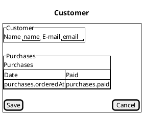

# Pisa User Guide

Pisa turns a short description of your data and architecture into a working web application — a REST API, web pages, tests and build files — in either Java (Spring Boot) or TypeScript (Hono + Prisma).

This guide covers **Pisa 0.15.0**. If anything here disagrees with `pisa --help`, trust the help output.

**Where to start:**

- **Brand new?** Read [How Pisa works](#how-pisa-works) (one minute), then [Install](#installing-pisa) and follow the [Quick start](#quick-start).
- **Prefer a guided tour?** Run `mkdir my-project && cd my-project && pisa init`, then `pisa play`. This lists three tutorials that build the same app step by step: the [Spring Boot (Java) tutorial](https://arcware-io.github.io/pisa/pisa-tutorial-spring-java/), the [Hono (TypeScript) tutorial](https://arcware-io.github.io/pisa/pisa-tutorial-hono-typescript/) (each takes about an hour) and the [single-tier tutorial](https://arcware-io.github.io/pisa/pisa-tutorial-single-tier/), a site without a server (about half an hour).
- **Changing a running application?** Read [Changing your application: features and stories](#changing-your-application-features-and-stories).
- **Looking something up?** Jump to the [Command reference](#command-reference), the [Spec file reference](#spec-file-reference) or [Troubleshooting](#troubleshooting).

## How Pisa works

In one sentence: Pisa is a spec-driven development tool with a generator at its core and a harness around its coding agent. The generator produces the code deterministically from your specs; the harness lets the language model act only through checked tools, with frozen tests and write protection.

You write **specs** — small text files that describe *what* you want. Pisa turns them into **code**. The specs are the source of truth; the code can always be regenerated from them.

Pisa splits the work in two:

- **The skeleton is deterministic.** Entities, relationships, REST routes and one input field per data type come straight from templates. No AI is involved: the same specs always produce the same code.
- **The finishing touches come from you.** How a form is grouped, ordered and labelled comes from a short description you write, with a sketch (a "Salt mockup") inside it. If you'd rather not draw the sketch, an AI model can propose one — but it only *proposes*. Pisa checks the proposal and writes it into your description file, where you can edit it like anything else.

Pisa works **spec-driven**, in four phases (after GitHub Spec Kit): *specify* (describe in prose, have a spec proposed and correct it), *plan* (the architecture plan, forms and use cases), *implement* (`generate`) and *check* (the generated tests, `replay`). A change is another round of the same phases; the tutorials follow them step by step.

### The spec files

The specs have three levels: the **base** (what the application is), **features** (a theme of change) and **stories** (one change, with acceptance criteria).

| What it describes | File | Who writes it |
| --- | --- | --- |
| Project type (Java or TypeScript, names) | `project.spec.json` | `pisa init` |
| Data model: entities, fields, relationships | `spec/base/*.dml` | You. `pisa propose-model` can draft it from a prose description. |
| Architecture: database, login, Docker, CI (optional) | `spec/base/*.adl` | You. `pisa propose-architecture` can draft it. |
| Form layout for one entity | `spec/base/<entity>.ui.md` | You. `pisa propose-layout` can add a sketch; `pisa propose-specs` writes one for every entity. |
| Use cases (become browser tests) | `spec/base/*.uc.md` | You. `pisa propose-specs` can draft them. |
| A feature: goal, scope, its stories | `spec/features/NNN-<feature>/feature.md` | `pisa story --specify` |
| A story: acceptance criteria, plan, tests, check | `spec/features/NNN-<feature>/stories/NNN-<story>/01-spec.md` … `05-check.md` | You and `pisa story` |
| Your own template changes | `.pisa/templates/<target>/` | You, via `pisa eject-templates` |

**Rule of thumb:** you own `spec/`; Pisa owns `.pisa/` and everything it generates under `src/`.

> **Older projects:** a project that has its spec files directly in `spec/` (no `spec/base/`) keeps working; Pisa reads and writes there. New projects start with `spec/base/`.

## Installing Pisa

Pisa is a single program with no dependencies — no Node, no Bun, nothing else to install (the generated project needs a JDK or Node.js: [Setting up your development environment](#setting-up-your-development-environment)). You can download it from the [releases page](https://github.com/Arcware-io/pisa/releases) of the public repository `Arcware-io/pisa` without a GitHub account or the GitHub CLI. This guide is also available as a website: <https://arcware-io.github.io/pisa/>.

**Pick the right file for your machine:**

| Your system | File to download |
| --- | --- |
| macOS, Apple Silicon (M1 or newer) | `pisa-darwin-arm64` |
| macOS, Intel | `pisa-darwin-x64` |
| Linux, x86-64 | `pisa-linux-x64` |
| Linux, ARM | `pisa-linux-arm64` |
| Windows, x86-64 | `pisa-windows-x64.exe` |
| Windows, ARM | `pisa-windows-arm64.exe` |

Not sure which you have? On macOS or Linux, run `uname -m`: `arm64` or `aarch64` means ARM, `x86_64` means x64. On Windows, look under *Settings → System → About → System type*.

> **Not tried by the author:** the install scripts and the Homebrew formula (they were read, not run), and Pisa on a real Linux or Windows machine.

### Option 1: Install script (macOS, Linux)

```bash
curl -fsSL https://raw.githubusercontent.com/Arcware-io/pisa/main/install.sh | sh
```

The script picks the right file, installs it to `~/.local/bin`, removes the quarantine mark on macOS, and tells you if that folder isn't on your PATH yet. To choose a version or folder:

```bash
curl -fsSL https://raw.githubusercontent.com/Arcware-io/pisa/main/install.sh | sh -s -- --version v0.15.0 --dir ~/.bin
```

### Option 2: Install script (Windows PowerShell)

```powershell
irm https://raw.githubusercontent.com/Arcware-io/pisa/main/install.ps1 -OutFile install.ps1; .\install.ps1
```

This installs `pisa.exe` to `$HOME\bin` and adds it to your PATH. Open a new terminal afterwards. Use `-Dir` to pick another folder or `-Version vX.Y.Z` for a specific release.

If PowerShell blocks the script, run `powershell -ExecutionPolicy Bypass -File .\install.ps1` instead.

### Option 3: Homebrew (macOS, Linux)

```bash
brew tap Arcware-io/pisa https://github.com/Arcware-io/pisa
brew install pisa
```

The formula downloads the same file from the release and checks its checksum. There is no tap name of its own, hence the address in the first command.

### Option 4: Install by hand

Download the file, make it executable and put it on your PATH.

**macOS / Linux** (swap in the file name for your system):

```bash
curl -fSL -o pisa https://github.com/Arcware-io/pisa/releases/latest/download/pisa-darwin-arm64
chmod +x pisa
mkdir -p ~/.bin && mv pisa ~/.bin/pisa   # make sure ~/.bin is on your PATH
pisa --version
```

**Windows:**

```powershell
Invoke-WebRequest https://github.com/Arcware-io/pisa/releases/latest/download/pisa-windows-x64.exe -OutFile pisa.exe
mkdir $HOME\bin -Force; Move-Item pisa.exe $HOME\bin\pisa.exe
setx PATH "$env:PATH;$HOME\bin"   # takes effect in a new terminal
pisa --version
```

**If your OS blocks it:**

- **macOS says the app "cannot be opened":** this is Gatekeeper. Run `xattr -d com.apple.quarantine ~/.bin/pisa`.
- **Windows SmartScreen warns you:** click *More info → Run anyway*.

### Updating

Run the install script again, or download the new file and replace the old one. `pisa --version` shows which version you're running.

## Setting up your development environment

Pisa itself needs nothing but its own file. The generated project needs a JDK (Spring) or Node.js (Hono), and a few tools make daily work with Pisa faster and more repeatable. None of this is required; take what you use.

### Java, Maven and the Maven Daemon with SDKMAN (Spring)

[SDKMAN](https://sdkman.io) installs and switches JDKs and build tools per user, without admin rights (macOS, Linux; on Windows use WSL or Scoop/Chocolatey):

```bash
curl -s "https://get.sdkman.io" | bash    # then open a new terminal
sdk list java                              # pick an identifier of a Temurin JDK 25, for example 25.0.4-tem
sdk install java <identifier>
sdk install maven                          # Maven; only needed if you do not use ./mvnw
sdk install mvnd                           # the Maven Daemon, see below
java -version
```

- **`./mvnw`, the Maven Wrapper:** a Spring project from `pisa init` contains `mvnw` (macOS, Linux) and `mvnw.cmd` (Windows). `./mvnw test` downloads the Maven version of the project on first use, so a machine with only a JDK builds the project. Docker and the generated `ci.yml` use it too. This guide and the tutorials write `./mvnw`; with an installed Maven, `mvn` does the same. On Windows (PowerShell, cmd) use `mvnw.cmd` instead of `./mvnw`.
- **`mvnd`, the Maven Daemon:** keeps a warm JVM between runs. The acceptance runs of `pisa story` (`--check`, `--implement`) are about 10 s faster per Maven run (16 s instead of 26 s measured on a small project). Pisa uses `mvnd` when it is on the `PATH`, else `./mvnw`, else `mvn`, and prints a warning to install `mvnd` when it is missing; it never installs anything itself. `PISA_MAVEN=mvnd`, `PISA_MAVEN=./mvnw` or `PISA_MAVEN=mvn` forces the choice. The daemon stays in memory after the run; `mvnd --stop` ends it. **The wrapper can use the daemon as well,** so that `./mvnw` runs `mvnd` without an installed one: `./mvnw -N wrapper:wrapper -Dtype=only-script -Dmvnd=<version>` (for example `1.0.6`) changes `.mvn/wrapper/maven-wrapper.properties` to download that `mvnd` (tried with 1.0.6 on macOS; the call also needs a network connection).
- **One JDK per project:** `sdk env init` writes a `.sdkmanrc` with the versions in use, and `sdk env` switches to them when you enter the folder. Commit the file so that others get the same JDK.

### Node.js with nvm (TypeScript)

A Hono project needs Node.js 24 or newer and npm. With [nvm](https://github.com/nvm-sh/nvm) (macOS, Linux; on Windows use [nvm-windows](https://github.com/coreybutler/nvm-windows) or Scoop/Chocolatey) you install and switch versions per project:

```bash
nvm install 24
nvm use 24
node -v
echo 24 > .nvmrc      # in the project: `nvm use` then picks this version
```

Other version managers (fnm, mise, asdf) work the same way; Pisa only looks at the `node` and `npm` on the `PATH`.

### Docker (optional)

PostgreSQL for development (`docker compose up -d db`), the container tests and the generated image need Docker. Docker Desktop, Colima or Podman with the Docker socket work. Without a `docker` block in the `.adl` you need none of it.

### IntelliJ IDEA or VS Code for the generated project

- **IntelliJ IDEA (Spring):** open the folder with `pom.xml`, accept "Load Maven project", and set the project SDK to the JDK from SDKMAN (*File → Project Structure → SDK*; SDKMAN JDKs lie under `~/.sdkman/candidates/java`). The run configuration of the application class starts the app; acceptance tests of a story run with the Maven profile `ac` (`./mvnw test -Pac -Dgroups=AC1`) or from the terminal with `pisa story --check`. Start IntelliJ from a terminal where `pisa` and `node` are found, or the IDE terminal does not see them.
- **IntelliJ IDEA (Hono):** open the folder, set *Settings → Languages & Frameworks → Node.js* to the Node from nvm, and run the npm scripts (`npm test`, `npm run typecheck`) from the *npm* tool window.
- **VS Code (Spring):** the extension packs *Extension Pack for Java* and *Spring Boot Extension Pack* run and debug the application and the JUnit tests. Set `java.jdt.ls.java.home` if the JDK of SDKMAN is not found.
- **VS Code (Hono):** TypeScript is built in; add the *Prisma* extension for `schema.prisma`. Run the scripts from the integrated terminal.
- **Both:** install the Pisa plugin and PlantUML as described in the next sections, and keep a terminal open in the project folder: `pisa`, `./mvnw` or `npm` and `git` all run there.

> **Not tried by the author:** only SDKMAN with the Maven Daemon (macOS) was run on a real machine. The other steps follow the documentation of the tools.

## Setting up a language model (optional)

Everything that generates code from your specs works without a model. Only the commands that ask a language model need one: the `propose-…` commands, `pisa story --specify|--plan|--test|--implement` and `pisa extend --specify|--test|--implement|--explain`. Pisa uses the `pi` coding agent, which resolves the provider and model you have configured locally; Pisa does not pin one. Two ways, both tried on a real machine:

**Anthropic login.** Authentication is a slash command in the interactive `pi` terminal UI: start `pi`, type `/login` and pick Anthropic. The credentials land in `~/.pi/agent/auth.json`, in one of two shapes that must not be mixed up (mixing them fails with a cryptic `invalid_state`):

```json
{ "anthropic": { "type": "oauth", "access": "...", "refresh": "...", "expires": 1234567890 } }
{ "anthropic": { "type": "api_key", "key": "sk-ant-..." } }
```

The first is a Claude Pro/Max login (`/login`), the second an API key from the Anthropic Console. Problems met in practice:

- `invalid_grant: Refresh token expired`: log in again with `/login`.
- `anthropic-workspace-id is required...`: a personal key of a multi-workspace Console organisation is not accepted; use `/login` or a workspace-scoped key.
- A billing message ("Third-party apps now draw from your extra usage ..."): the account has no Extra Usage credit. This is account billing, not a Pisa error.

**Reuse the credentials of Claude Code.** The community extension [`pi-claude-auth`](https://github.com/pankajudhas81/pi-claude-auth) reads the tokens Claude Code has stored and copies them into `auth.json`, so no second login is needed (`pi install npm:@pankajudhas81/pi-claude-auth`; Claude Code must be installed and logged in). Its own README notes that Anthropic's terms limit subscription tokens to official clients: this is a workaround, not an Anthropic-sanctioned integration, and it may break. Mentioned for transparency, not as a recommendation.

A local model through llama.cpp works as well (`/login llama.cpp` in `pi`), but inference on Apple Silicon was too slow for a comfortable loop. Not verified here: these steps with the compiled `pisa` binary instead of a source checkout.

## Setting up your editor (optional)

Pisa works fine without any of this. But two add-ons make writing specs much nicer:

1. **The Pisa editor plugin** gives `.dml` and `.adl` files syntax colours, live error checking, auto-formatting ("Format Document" in VS Code, Reformat Code in IntelliJ) and "go to definition". The style is 4 spaces, `{` at the end of the line, one field per line. A file with a syntax error is not changed. Every time you save a `.dml` file, the plugin also draws a class diagram of your model (`domain-model.puml` and `domain-model.md` next to it).
2. **PlantUML** turns those diagrams and your form sketches into actual pictures instead of text.

### VS Code

**Pisa extension** (needs VS Code 1.85+; no separate Node install needed):

```bash
code --install-extension dml-vscode-extension-<version>.vsix
```

Get the `.vsix` file from the GitHub release. You can also install it via *Extensions → ⋯ → Install from VSIX…*

**PlantUML extension:**

```bash
code --install-extension jebbs.plantuml
```

Press `Alt+D` (`Option+D` on Mac) to preview a diagram. It renders locally with Java and Graphviz.

> **Gotcha — Markdown preview shows "No PlantUML server":** the Markdown preview (`Cmd+Shift+V`) can't render diagrams locally, even if Java and Graphviz are installed. It needs a PlantUML server. You have two choices:
>
> - **Run your own (private):** `docker run -d --name plantuml -p 8090:8080 plantuml/plantuml-server:jetty`, then set `"plantuml.server": "http://localhost:8090"` in your settings. (Port 8090 avoids clashing with your app on 8080.) The command has not been tried here.
> - **Use the public server:** set `"plantuml.server": "https://www.plantuml.com/plantuml"`. Your diagrams are sent over the internet, so don't use this for confidential models.

### IntelliJ IDEA

**Pisa plugin** (needs IntelliJ 2024.3+ and Node.js installed):

1. Download `dml-intellij-plugin-<version>.zip` from the GitHub release.
2. Go to *Settings → Plugins → ⚙ → Install Plugin from Disk…* and choose the zip. IntelliJ also installs the required **LSP4IJ** plugin.
3. Restart IntelliJ and open a `.dml` file. You should see colours and error markers. The server is called "Pisa Language Server (DML, ADL)".

**If the plugin can't find Node** (common on Windows, and on macOS when IntelliJ is launched from the Dock), set `DML_NODE` to your Node executable and restart IntelliJ. On Windows this is **required**, because the plugin only looks for `node`, not `node.exe`:

```bash
# macOS / Linux: start IntelliJ from this terminal afterwards
export DML_NODE=$(which node)
```

```powershell
# Windows (permanent). Use `where node` to find the path.
winget install OpenJS.NodeJS.LTS
setx DML_NODE "C:\Program Files\nodejs\node.exe"
```

**PlantUML plugin:** in *Settings → Plugins → Marketplace*, search for **PlantUML integration**. If some diagrams don't draw, set the Graphviz path under *Settings → Languages & Frameworks → PlantUML* (Salt mockups need no Graphviz). If the Markdown preview only shows source text for ```` ```plantuml ```` blocks, look for a PlantUML extension in *Settings → Languages & Frameworks → Markdown*.

### Installing PlantUML and Graphviz on your machine

The editor plugins need PlantUML, Graphviz and Java (JDK 17+) to render locally. Pisa itself does **not** call PlantUML; it only writes the text.

```bash
# macOS
brew install plantuml graphviz

# Debian / Ubuntu
sudo apt install plantuml graphviz
```

```powershell
# Windows (or: scoop install plantuml graphviz)
choco install plantuml graphviz
winget install EclipseAdoptium.Temurin.25.JDK   # if you don't have Java yet
```

Check it worked with `plantuml -version` and `dot -V`. On Windows, if `dot` isn't found, set `GRAPHVIZ_DOT` to `C:\Program Files\Graphviz\bin\dot.exe`.

Menu names vary between editor versions, so use the ones in your version if they differ from the above.

## Quick start

In about ten minutes you'll have a running Spring Boot app with a REST API and web pages for a small shop. No AI and no internet connection needed.

### What you need

- **Pisa** on your PATH (`pisa --version` should work).
- **JDK 25** (17 and 21 also work with `--java`) and **Maven** (Windows: `choco install maven` or Scoop). The project brings the Maven Wrapper `./mvnw`, so the JDK alone is enough to build it; how to install both: [Setting up your development environment](#setting-up-your-development-environment).
- *Optional:* the editor plugins and PlantUML from the previous section.
- An AI model is needed **only** for the `propose-model`, `propose-architecture` and `propose-layout` commands. This quick start doesn't use them. How to set one up: [Setting up a language model](#setting-up-a-language-model-optional).

The commands below are written for Bash. In PowerShell, replace a trailing `\` with a backtick.

### Step 1: Create the project

```bash
pisa init --target spring-boot --out ./shop --group ch.example --artifact shop
```

This creates an empty Spring Boot project that already starts (`pom.xml`, the Maven Wrapper `mvnw`, `mvnw.cmd` and `.mvn/wrapper/`, application class, a test, `application.yml`, `README.md`; with `./mvnw` you need no Maven installed; Dockerfile and `ci.yml` use it too). You also get:

- `spec/base/` — where your spec files go, and `spec/README.md`, a cheat sheet (which files there are, a short `.dml` reference, a form and a use case example).
- `doc/` — a copy of this guide and the tutorials, matching your Pisa version.
- `project.spec.json` — records the project type, so later commands don't need `--target` again:

```json
{
  "target": "spring-boot",
  "groupId": "ch.example",
  "artifactId": "shop",
  "basePackage": "ch.example.shop",
  "javaVersion": "25",
  "database": "h2"
}
```

Pisa never overwrites an existing `README.md` or `spec/README.md`, even with `--force`.

### Step 2: Describe your data

Create `spec/base/shop.dml`:

```
entity Customer {
    @id id: Long
    name: String
    email: String? unique
    oneToMany purchases: Purchase mappedBy customer
}

entity Purchase {
    @id id: Long
    orderedAt: Date
    paid: Boolean
    manyToOne customer: Customer
}
```

This says: a customer has a name, an optional unique email, and many purchases. Each purchase has a date, a paid flag and belongs to one customer. The full syntax is in the [`.dml` reference](#data-model-dml). You can split your model across several `.dml` files in `spec/base/` — Pisa reads them all as one model.

### Step 3: Generate the code

```bash
cd shop
pisa generate --file spec/base/shop.dml --out .
```

Pisa checks your model first and only writes files if it's valid. For each entity you get a database class, a repository, a REST controller (e.g. `/api/customers`, with paging) and a web page to list, create, edit and delete records. You also get a start page with a menu and a class diagram of your model (`spec/base/domain-model.md`).

> Everything under `src/` is rewritten on each `generate`. Don't edit those files by hand — change the specs instead, or [customize the templates](#customizing-templates).

### Step 4: Run it

```bash
./mvnw spring-boot:run
```

- Web UI: http://localhost:8080/
- API: http://localhost:8080/api/customers

The database lives in memory, so your data disappears when you stop the app. See [Switching from H2 to PostgreSQL](#switching-from-h2-to-postgresql) to use PostgreSQL instead.

### Step 5 (optional): Design the form layout

By default, each page shows all fields in a single column. To change that, create a form description:

```bash
pisa propose-layout --entity Customer --out .
```

This creates `spec/base/customer.ui.md` with a starter text that lists the fields of the form. Replace its contents with a description and a sketch (a PlantUML "Salt" mockup):

````markdown
# Form: Customer

Name and e-mail side by side, below them the purchases as a table.


````

Run `pisa generate --file spec/base/shop.dml --out .` again. The Customer page now has name and email on one line, purchases in a table, and Save/Cancel buttons. The sketch *is* the layout — there's no separate layout file. If the sketch later no longer matches the model (a field added or removed), `generate` stops with the line and writes nothing. Mockup syntax is in the [`.ui.md` reference](#form-layout-uimd).

**Shortcut:** `pisa propose-specs --out .` drafts a form sketch (in a Bootstrap look) for every entity plus a set of use cases, without AI. Each use case becomes an automated browser test on the next `generate`.

### Step 6 (optional): Prove it's reproducible

Pisa records every step in `.pisa/recipe.json`. You can rebuild the project from scratch and confirm every file matches:

```bash
pisa replay --from ./shop --out ./shop-copy
```

It finishes with `All N generated file(s) match the hashes recorded in the recipe.`

### What you ended up with

```
shop/
  project.spec.json         project type                   (written by init)
  spec/base/shop.dml        your data model                (you)
  spec/base/customer.ui.md  form description + sketch      (you)
  .pisa/recipe.json         log of every Pisa step         (Pisa)
  pom.xml, src/…            the Spring Boot app            (init / generate)
```

## Going further

### Building in TypeScript instead of Java

The same specs can produce a TypeScript app (Node.js 24, **Hono** for HTTP, **Prisma** for the database). The REST API (`/api/<entity>`, paging with `?page=&size=`) and the web pages are identical — a user can't tell the difference.

You pick the language in your architecture file (see [the next section](#describing-your-architecture-adl)) with one line:

```
container api : backend {
    runtime hono        // spring (default) or hono
    uses db
    components layered
}
```

Then:

```bash
pisa init --out ./library-ts --adl library.adl   # no --target needed
cd library-ts                                    # put your .dml, .ui.md, .uc.md into spec/base/
pisa generate --file spec/base/library.dml --out .
npm install
npm start                                        # http://localhost:8080/
```

Without `runtime`, `--target` applies, otherwise Spring Boot. If both name something, they must agree. If you change `runtime` in an existing project, `generate` stops and names the command to run: `pisa init … --adl … --force`.

**How the two compare:**

|  | Spring Boot (Java) | Hono + Prisma (TypeScript) |
| --- | --- | --- |
| Build config | `pom.xml`, `application.yml` | `package.json`, `prisma.config.ts`, `src/db.ts`, `application.yml` |
| Code | JPA class, repository, controller | `src/model`, `src/repository`, `src/route` (style `layered`: also `src/service`, `src/dto`, `src/mapper`) |
| Database tables | Created by Hibernate | `prisma/schema.prisma`, applied by `npm start` |
| Embedded database | H2 (in memory) | SQLite (a file) |
| Tests | `./mvnw test`, browser tests `./mvnw test -Pui` | `npm test`, browser tests `npm run test:ui` |
| Architecture test | `ArchitectureTest` (ArchUnit) | `test/architecture.test.ts` (route → service → repository, only `db.ts` knows Prisma) |

The tests run on Node.js; `bun test` forwards to `npm test`. Before the first browser test run, install the browser with `npx playwright install chromium`. The generated `README.md` has full build, run and test instructions.

**TypeScript limitations today:** no `manyToMany`, no `oneToMany` without `mappedBy`, no `oneToOne` without `composed`. IDs are always 32-bit integers. The `package` line of the `.adl` is ignored. Never run `prisma db push --force-reset` — it deletes all data. PostgreSQL was checked against a real container (`postgres:17`, 2026-10-21).

### Restricting what can be done with an entity

By default, every entity can be created, read, updated and deleted. To forbid some operations for *everyone*, add `@operations` above the entity (after `@table`, if there is one):

```
@operations(create, read, update)    // companies can never be deleted
entity Company {
    @id id: Long
    name: String unique
    oneToMany employees: Person mappedBy company
}
```

Use this for data that's inherently fixed — reference data, imports, audit logs. For rules that depend on *who* the user is, use [roles](#adding-login-users-and-roles) instead. Pisa never restricts anything by itself, and the AI proposals don't suggest it.

**Rules:**

- `read` is always required.
- Allowed values are `create`, `read`, `update`, `delete`, each at most once. They are not keywords: a field called `read` stays possible.
- Not allowed on a `composed` part — put it on the parent entity instead.

**What changes in the app** (the same for Spring and TypeScript):

| Operation removed | API | Web page |
| --- | --- | --- |
| `delete` | `DELETE` returns **405** with an `Allow` header | No delete button |
| `create` | `POST` returns **405** | No "create" form |
| `update` | `PUT` returns **405** | No edit button; clicking a row opens it read-only |

The generated tests adapt automatically: they check for 405 instead of the missing operation, and create the rows they need directly through the repository where `create` is missing. Repository and service stay complete — the block applies at the interface and in the pages. A forbidden operation returns **405** even for admins. (405 means "this entity can't do that"; 403 means "*you* aren't allowed to".)

**Watch out:**

- **Roles:** the rights of a role are *intersected* with `@operations`. If `ADMIN` may do everything but `Company` has no `delete`, even `ADMIN` can't delete a company.
- **Use cases:** if a use case tests an operation you've removed (`Test: delete` needs `delete`, `edit` needs `update`, `create` needs `create`; for a part the root counts), `generate` stops with an error and writes nothing: `UC6 (spec/base/use-cases.uc.md): Company doesn't allow "delete" (@operations(create, read, update)) but the test line says "delete"`. Fix the use case or the `@operations` line.
- **Pisa never deletes:** if you delete a use case, its old browser test file stays behind and will fail. `generate` lists these files (`Info: browser tests of use cases that are no longer in …`) — delete them yourself.

To allow everything again, remove the `@operations` line and run `generate`. A worked example is step 7a of the tutorials.

### Adding login, users and roles

By default the app has no login and everything is open. Add one line to the backend in your `.adl` to turn on login (same for Spring and TypeScript):

```
container api : backend {
    authentication session
    roles {
        ADMIN                       // no block = can do anything the entities allow
        USER {
            Company: read, update   // only these operations on Company
        }                           // all other entities stay fully allowed
    }
}
```

If you leave out `roles`, you get `ADMIN` and `USER`, both with full access. Use `*: read` inside a role to set a default for all other entities. The editor checks the block (a role only once, an entity only once per role, only the four operations; an unknown entity is a warning) and supports *Go to Definition* on entity names. `generate` checks that the entities exist (`security.yml is not valid: … no entity …`). `propose-architecture` writes the block if your description names roles and their rights.

Then run `pisa init … --adl … --force` and `generate`. Pisa creates:

- A **`security.yml`** file listing roles and users. Pisa writes it once and never overwrites it — it's yours to edit. To regenerate it from the `.adl`, delete it first.
- A **login page** (`login.html`) and a **change-password page**.
- One **starter user per role**: `admin` for ADMIN, `user` for USER, and the lowercase role name for any other role.

```yaml
roles:                                   # what a role may do per entity ("*" = every entity)
  ADMIN:
    "*": [create, read, update, delete]
  USER:
    "*": [create, read, update, delete]
    "Company": [read, update]            # the list of an entity replaces "*"
users:
  - { name: admin, roles: [ADMIN], mustChangePassword: true }
  - { name: user,  roles: [USER],  mustChangePassword: true }
```

**Logging in for the first time:** each starter user's password is the same as their username (e.g. `admin` / `admin`; the app hashes it at start). After logging in, you must choose a new password on the change-password page (typed twice, 8+ characters, at most 72 bytes, not your username). Until you do, the API answers everything else with `403 password change required`.

> These starter passwords are public knowledge. They're for development only.

**Where passwords live:** chosen passwords are stored as bcrypt hashes in the app's database (table `usr_password`), never in plain text and never in `security.yml`. To reset a forgotten password, delete that user's row from `usr_password`. With the in-memory H2 database, this table empties on every restart (start password and forced change apply again); with PostgreSQL and SQLite the password stays.

**Adding a user or role:** edit `security.yml` and restart the app — no `generate` needed. To give a user a starting password other than their name, run `pisa hash-password` and paste the hash into a `password:` field. `generate` and the app reject a `password` that isn't a bcrypt hash. The same file works for both targets.

- **Spring:** `security.yml` is in `src/main/resources/` (in the jar: rebuild after changes).
- **TypeScript:** `security.yml` is in the project folder.

**How permissions work:** a user's rights are the union of all their roles, *limited by* the entity's `@operations`. A role can never do more than the entity allows.

**What users see:**

- Not logged in: the API returns **401**; pages redirect to the login page.
- Logged in but not allowed: **403**. What the entity doesn't allow at all: **405**.
- Pages only show the buttons the user is allowed to use. A ☰ menu at the top right shows who's signed in, plus "Change password" and "Sign out". (The pages get the rights from `GET /api/me`.)
- **Display mode:** clicking a table row opens the record read-only (fields locked, no save button). Users who may `update` see an **Edit** button. You can link straight to a record with `<page>.html#view=<id>` or `#edit=<id>`. Today the display mode follows the rights alone; you can't switch it on or off in the specs.
- **Session:** a cookie; with Spring with a CSRF token, with TypeScript `HttpOnly` and `SameSite=Lax`. The H2 console (Spring) is for `ADMIN` only.

**Testing:** the generated tests use their own test users (in `src/test/resources/security-test.yml` or `test/security-test.yml`, hashes only), so they don't depend on your `security.yml`: `tester` may do everything the entities allow, `nobody` nothing, and there's one test user `as-<role>` per role. The tests check 401/403, the forms, `/api/me`, the password change and — for every role and every entity — what the role may do (`RolesTest` or `test/api/roles.test.ts`). A browser test goes through the first login.

**To turn login off:** remove the line from the `.adl`, run `init … --force`, then `generate`. Pisa deletes the login files it created, unless you changed them (then it prints the `rm` command). `security.yml` stays yours.

**Moving up from 0.12.x:** `init --force` removes the old password file. Passwords users chose earlier no longer apply.

**Not supported:** user management in the browser, password reset by email, JWT tokens, external login providers (Keycloak, OIDC), per-field or per-row permissions, HTTPS, or limits on login attempts.

### Changing your application: features and stories

Once the application exists, a change starts as a **story**: a short text that says what the change must achieve, with **acceptance criteria** written from the requester's point of view (when is it done, as the requester asked for it?). Stories live in `spec/features/`, next to the base specs in `spec/base/`:

```
spec/
  base/                                  the base: .dml, .adl, .ui.md, .uc.md
  features/
    001-user-login/
      feature.md                         goal, scope, the list of its stories
      stories/
        001-user-login/
          01-spec.md … 05-check.md       one file per phase
```

`pisa story` works through five phases, one file each:

```bash
pisa story --specify "User can log in"   # the model writes the story, chooses the feature, asks; 01-spec.md with the criteria
pisa story --plan                        # 02-plan.md: one task per criterion
pisa story --test                        # 03-test.md: freezes the acceptance tests
pisa story --implement                   # 04-implement.md: assignment and open tasks
pisa story --check                       # runs the acceptance tests, writes 05-check.md
```

The model chooses the feature the story belongs to (the first story starts the first feature); to decide yourself, name it: `pisa story --specify "…" --feature 001`. A step-by-step course with real output is step 13 of the [Hono tutorial](https://arcware-io.github.io/pisa/pisa-tutorial-hono-typescript/). The details of every option are in [`pisa story`](#pisa-story).

The acceptance tests of a story run **only on demand** — with `./mvnw test -Pac` (Spring) or `npm run test:ac` (Hono), never in the normal build. The CI only checks that every story with a plan has a report without failures.

## Describing your architecture (.adl)

An `.adl` file describes everything about your app *except* the data: which language, which database, whether there's a login, and optional extras like Docker, GitHub CI and cloud deployment. It follows the C4 levels: **containers** (database, backend, frontend) and, in the backend, **components** (`crud` or `layered`). It's optional — without one, you get a Spring Boot app with an in-memory database.

Here's a full example. Everything after `container web` is optional:

```
architecture Library {
    container main : database {
        engine postgresql        // h2 (Spring only) | sqlite (TypeScript only) | postgresql
        name library
    }
    container api : backend {
        runtime spring           // spring (default) | hono
        package ch.ffhs.cas.library
        uses main
        components layered       // crud | layered
        versions { archunit "1.6.0" }
    }
    container web : frontend {
        servedBy api
    }
    scm {                        // GitHub templates
        host github
        pullRequestTemplate
        issueTemplates
    }
    pipeline {                   // GitHub workflows
        ci github
        release github
        deploy render            // needs the docker block; `deploy pages` instead: a single-tier site on GitHub Pages
    }
    docker {
        image "library"
        compose
    }
    sampleData {                 // example data for development (only h2 or sqlite)
        entries 8
        locale "de-CH"
    }
}
```

Apply it when creating the project:

```bash
pisa init --target spring-boot --out ./library --adl library.adl
```

Pisa checks the file (errors show file, line and column and stop before anything is written), copies it to `spec/base/`, and uses it to set up the project. A project can have only one `.adl`; it's part of the recipe, and `replay` restores it.

> **Changing the `.adl` later?** Build files like `pom.xml` are written once, at `init`. So after editing the `.adl`, `generate` will stop and tell you what changed (e.g. `style: plan layered, library.adl says crud`). Run `pisa init … --adl spec/base/library.adl --force` to apply the changes, then `generate` again.

### What each part does

| In the `.adl` | What it does |
| --- | --- |
| `runtime spring` / `hono` | Java or TypeScript ([details](#building-in-typescript-instead-of-java)). Without it, `--target` applies, otherwise `spring-boot`. |
| `engine h2` / `sqlite` / `postgresql` | Which database to use (`sqlite` only with `hono`; with Spring it is an error). For PostgreSQL without an earlier password, the development login `app` / `app` is used. |
| `components crud` / `layered` | Code structure. `crud` = controller → repository. `layered` adds a service layer, DTOs and mappers. |
| `authentication session` + `roles { … }` | Login with users and roles ([details](#adding-login-users-and-roles)) |
| `package` | Java base package (`--package` must not contradict it) |
| `versions { … }` | Pin specific library versions; the others stay |
| `docker { … }` | Dockerfile and Docker Compose ([below](#docker)) |
| `pipeline { … }` | GitHub CI, releases, Render deployment ([below](#github-ci-and-releases)) |
| `scm { … }` | GitHub pull request and issue templates |
| `sampleData { … }` | Realistic example data from the model in the running development system ([below](#example-data)) |
| `servedBy api` | The frontend is delivered by the backend (documentation only: the pages are always served by the backend) |
| `storage json` | A site with **no backend and no database**: the data is one JSON file kept in the browser ([below](#a-single-tier-site-no-server)) |
| `package zip` | With `storage json`: `npm run package` makes the site a ZIP file |

What the file doesn't name (packages, ports, users, console) stays as it is in the plan. The `pipeline`, `scm`, `docker`, `ci`, `release`, `host`, `image`, `compose` and similar words are keywords and no longer work as part of a package name (`package io.github.x` still does).

**App name:** the start page shows the name after `architecture` (here "Library") as its heading and as the browser tab title. It's stored as `app.title` in `application.yml`, which `init` writes once. To change it, edit it there and restart; no `generate` needed. Without an `.adl`, the artifact ID is used.

### Switching from H2 to PostgreSQL

1. Change the database to `engine postgresql` in the `.adl`.
2. Run `pisa init … --adl … --force`.
3. Run `pisa generate …`.
4. Start the database with `docker compose up -d`.

Pisa deletes files the new setup no longer needs (like `H2TcpServerConfig.java`, which breaks the build with "Package org.h2.tools does not exist") — but only if they look exactly like what Pisa wrote (the hash in the recipe matches). It prints `Info: deleted, no longer used by …` with one file per line. A file you changed stays; Pisa lists it with `Delete them with: rm …` and you remove it yourself. This also applies when switching from `layered` to `crud` (the folders `dto/`, `mapper/`, `service/` need Lombok and MapStruct, which the new `pom.xml` no longer has), after changing the `artifactId` (two main classes break `mvn package`), and for an old `compose.yaml`.

### Docker

Add a `docker` block to get a `Dockerfile` and `.dockerignore`. Add `compose` to also get a `compose.yml`. With PostgreSQL, you always get `compose.yml` (the app needs it to find the database). Without the block nothing is created.

```bash
docker compose up --build    # start app (and database)
docker compose up -d db      # start only the database, for local development
```

`image "name"` sets the image name (defaults to the artifact ID; lower case letters, digits, `.`, `_`, `-`, `/`, no tag). The files:

| File | Spring | Hono |
| --- | --- | --- |
| `Dockerfile` | Two stages: Maven with Temurin builds the JAR (without tests), a JRE runs it; user `app`, port 8080; with H2 the TCP server is off | `node:24-slim`, all dependencies, `prisma generate`, user `node`, starts with `npm start`; the SQLite file is in `/data` |
| `compose.yml` | Service `app`; with PostgreSQL also the service `db` (health check, `app` waits for it) | The same, with a volume `/data` for the SQLite file and `DATABASE_URL` |

Users and roles are baked into the image, so rebuild after changing `security.yml`. With H2 in a container a chosen password is gone with the container; with Hono the `/data` volume keeps it. Port 8080 is fixed in `compose.yml` — change it there if it's taken (e.g. `"8081:8080"`). `Dockerfile` and `.dockerignore` are created once and then belong to you; `compose.yml` comes from the plan and is rewritten by `init --force`. The generated `README.md` has a section "Run in Docker".

> **Mac gotcha:** if the build hangs looking up a base image (a hanging `docker-credential-desktop get`), Docker Desktop's credential helper is stuck. Point `DOCKER_CONFIG` at a folder whose `config.json` has no `credsStore`.

**Checked** (2026-10-22): image built and container started for Hono with SQLite and Spring with H2; `docker compose up --build` for both with PostgreSQL; the login works in the container.

### GitHub CI and releases

- **`ci github`** writes `.github/workflows/ci.yml`. It runs on every push to `main` and every pull request, with the fast tests and the browser tests as separate jobs:

| Target | Job `tests` | Job `browser-tests` |
| --- | --- | --- |
| Spring | `./mvnw -B test` (with PostgreSQL `-Ptestcontainers`) | install the Playwright browser, then `./mvnw -B test -Pui` |
| Hono | `npm install`, `npm run typecheck`, `npm test` (Node 24; with PostgreSQL a `postgres` service) | `npx playwright install --with-deps chromium`, `npm run test:ui` |

- **`release github`** writes `.github/workflows/release.yml`. Push a tag like `v1.0.0` (`git tag v1.0.0 && git push origin v1.0.0`) to run the tests and create a GitHub release with generated notes (with the JAR attached for Spring). Without `ci` the editor warns: the tests then run only at the tag.
- **`scm { host github … }`** writes a pull request template (description, changes, a checklist with the test command and the hint to change `spec/` instead of generated code) and issue forms (`bug_report.yml`, `feature_request.yml`, `config.yml`). Both lines need `host`, and `host`, `ci` and `release` must name the same system.

All these files are created once and then belong to you — even `init --force` won't overwrite them. GitHub is the only supported host today. Pisa has **not yet run these files on GitHub**: whether the jobs turn green there is unchecked.

### Deploying to Render

`deploy render` (inside `pipeline`) runs your app as a Docker image on [Render](https://render.com)'s free web service. It requires the `docker` block. Pisa writes two files, once:

| File | Content |
| --- | --- |
| `render.yml` | The blueprint: Docker, plan `free`, region Frankfurt, auto deploy off, health check path (`/login.html` with login, otherwise `/`), `PORT=8080`; with PostgreSQL the connection as environment variables Render asks for |
| `.github/workflows/cd.yml` | On a tag `v*`, calls the service's deploy hook (the secret `RENDER_DEPLOY_HOOK_URL`) |

**One-time setup:**

1. Push the project to GitHub.
2. On dashboard.render.com, choose **New ▸ Blueprint**, pick your repo, and enter `render.yml` as the **Blueprint Path**.
3. In the service's **Settings ▸ Deploy Hook**, copy the URL. Save it in GitHub under **Settings ▸ Secrets and variables ▸ Actions** as `RENDER_DEPLOY_HOOK_URL`. The URL is secret; Pisa never writes it into a file.
4. Push a tag to deploy. Only the hook deploys, so only releases.

**Free tier limits:** the service sleeps after 15 minutes idle (about a minute to wake), has 750 instance hours a month and no persistent disk. H2 and SQLite data — including chosen passwords — are lost on every restart. Render's free PostgreSQL expires after 30 days, so `deploy render` with `engine postgresql` warns and creates no database: bring your own. **Not checked:** a real deploy.

### Example data

An empty application is hard to judge. Add a `sampleData` block and the generated project fills itself with realistic records when it starts, made from your model with a Faker library: [datafaker](https://www.datafaker.net/) for Spring, [`@faker-js/faker`](https://fakerjs.dev/) for Hono.

```
sampleData {
    source faker       // where the values come from; faker is the only source for now
    entries 8          // records per entity, 1 to 10 (default 5)
    locale "de-CH"     // language and region of the values (default "en")
}
```

All three lines are optional, and an empty block `sampleData { }` means the defaults. The editor completes `source`, `entries` and all locales (`"de-CH"`, `"en-US"`, …). The block is only for the development databases `h2` and `sqlite`: with `engine postgresql` it is an error, because PostgreSQL is the lasting database. Without the block nothing is made.

**What you get**

- At most `entries` records per entity (never more than 10), in the order the entities point to each other: the targets of a `manyToOne` first, so every record has a reference. A composed part is made with its owner.
- Values that fit the field. The model comes first: an `Email`, `Phone` or `Url`, a range such as `Int(0..150)`, a pattern, a length, `unique` (no doubles) and an `enum`. Then the field name: `firstName`, `lastName`, `street`, `city`, `zip`, `country`, `email`, `company`, `description` and the like get matching values, and `name` and `title` depend on the entity (the `name` of an `Author` is a person, of a `Company` a company). Other fields get a short phrase. A `Country` with a `code` and a `name` gets the country of the code.
- The same data on every start: the Faker library runs with a fixed seed. User names and passwords of the login are never made.

**When it runs**

| | Spring | Hono |
| --- | --- | --- |
| Where | `SampleDataLoader` in the package `<base>.sampledata` | `src/seed.ts` |
| On | `app.sample-data.enabled: true` in `application.yml` | `SAMPLE_DATA` not `false` when `npm start` runs; `npm run seed` runs it alone |
| Off | The tests (`application.properties` in `src/test/resources`) and the Docker image (`APP_SAMPLE_DATA_ENABLED=false`) | The tests (they don't start the server) and the Docker image (`SAMPLE_DATA=false`) |
| Library | `net.datafaker:datafaker` (plan key `versions.datafaker`) | `@faker-js/faker` (plan key `versions.fakerJs`) |

The records are made only when the database is empty, so a SQLite file with data is left alone. To see the demo data in a container, set the variable to `true` in the `Dockerfile` (it is yours after the first write). Delete the block and run `init --force` and `generate`: the loader or the seed is then removed (or listed, if you changed it).

**Checked** (2026-11-18): a project from the address book model with `entries 5` and `locale "de-CH"`, for Spring with H2 (the tests pass, the application starts with 5 persons, their addresses and 5 countries) and for Hono with SQLite (`npm run typecheck`, `npm start`; the second start leaves the data alone). **Not checked:** the layered style and `unique` fields in a running project, PostgreSQL with Hono, the other locales (each Faker library knows its own set; where a region has no data, the language or English is used).

### A single-tier site (no server)

The same model can run with one tier only: a web site of plain HTML and Alpine.js, with no backend and no database. Its data is one JSON file: kept in the browser, and saved and loaded as a file. Only the `.adl` changes; the `.dml` is the same one you would give Spring or Hono. A step-by-step course: the [single-tier tutorial](pisa-tutorial-single-tier.md) (`pisa play single-tier`).

```
architecture Library {
    container web : frontend {
        technology alpine
        storage json                     // the data is one JSON file
        versions { alpinejs "3.17.5" }   // optional: versions of the libraries the pages load (alpinejs, bootstrap, validator, fakerJs)
        package zip                      // optional: npm run package makes dist/<artifact>.zip
    }
    sampleData { entries 5  locale "de-CH" }   // optional: example data on the first visit
    scm { host github }                        // optional, as always
    pipeline { ci github  release github  deploy pages }   // optional: deploy pages publishes the site on GitHub Pages
}
```

```bash
pisa init --out ./library --artifact library --adl library.adl     # the target alpine-json comes from `storage json`
# or the smallest description, written for you (with `sampleData { locale "de-CH" }`, so the site starts with Swiss example data):
pisa init --target alpine-json --out ./library --artifact library
cd library && pisa generate --file spec/base/library.dml --out .
npm start                                                           # http://localhost:8080
```

**Rules.** `storage json` means *exactly one container*: no backend, no database, no second frontend (one JSON file is the whole storage). `servedBy`, `docker` and `deploy render` are errors with it, because there is no server to deliver, to put in an image or to run (`deploy pages` is the one deploy that is possible, see below); a login and roles live in a backend, so they are not possible either. `scm`, `ci`, `release`, `sampleData` and `versions` work as before. `deploy pages` is **only** possible with `storage json` (and needs no `docker`); with a backend it is an error. The relations are the ones of the Hono target: `manyToOne`, `oneToOne … composed` and `oneToMany … mappedBy`.

**What you get.** Static files in `public/`: `index.html`, one page per entity (`persons.html`; a composed part has no page of its own), `app.js`, `app.css`, and `schema.js` (the rules of the model), `store.js` (the data) and, with `sampleData`, `sample-data.js`. The pages are the same Alpine.js pages as in the other targets. The libraries (Alpine.js, Bootstrap, validator.js, and `@faker-js/faker` for example data) come from the jsDelivr CDN, with the versions of the plan, so the site needs the network for them.

**How the data is kept.** `store.js` answers the requests of the pages the way the REST API of the other targets does (the same rules: required values, lengths, ranges, patterns, `Email` and `Url`, `unique`; an unknown row is a 404, an operation that `@operations` does not allow a 405, a row that another row still refers to a 409). Every change is saved in the browser (`localStorage`), so the data is still there after a reload. **Save data** in the menu (the hamburger button in the top bar) writes all data as a JSON file with one list per entity; **Load data** replaces the data with such a file, and a file that is not valid (not JSON, an unknown entity, a broken rule, a reference to a row that is not there) changes nothing. With `sampleData`, **Reset to example data** in the same menu throws the data away and makes the example data again; if the example data cannot be made (they need the CDN), the page says so. With `sampleData`, the first visit of a browser that holds no data gets the example data (a fixed seed, at most 10 records per entity).

**Tests.** `npm test` runs an architecture test: no file of `public/` may call a server (`fetch`, `XMLHttpRequest`, `WebSocket`, `EventSource`, `sendBeacon`). `npm run test:ui` runs one Playwright test per page: create, edit and delete through the form, and the row is still there after a reload (the first run needs `npx playwright install chromium`).

**Checked** (2026-11-19): the address book model with `sampleData`, `package zip` and `ci`/`release`: the generated architecture test, the Playwright tests in Chromium, Save data and Load data in a real browser (a broken file changes nothing), `npm run package` (a ZIP with the eight files of the site), and a store test in Node for every rule above. **Not checked:** a GitHub Actions run of the workflows, browsers other than Chromium, more data than `localStorage` takes (about 5 MB), the use cases (`.uc.md`; they make no test for this target yet).

**GitHub Pages.** `pipeline { release github  deploy pages }` (with `scm { host github }`) writes `.github/workflows/pages.yml`, once (then it is yours): on a tag `v*` and by hand (Actions, Pages, Run workflow) it runs `npm test` and hands the folder `public/` to the official GitHub Pages actions (`actions/configure-pages`, `upload-pages-artifact`, `deploy-pages`). The site is static files, so nothing is built. It is served below the name of the repository (`https://<owner>.github.io/<repository>/`), so every link and script of the pages is relative; the generated architecture test fails if a page has a link that starts with a slash. Save data and Load data work on the published page because they run in the browser; the data is in the browser of whoever opens the page (everybody has data of their own). What you do once:

1. A **public** repository (a free GitHub account serves Pages only from a public one; check GitHub's current rules for your plan): `gh repo create <name> --public --source . --push`. When `pisa init` has made the repository it prints this command with `--public` for a plan with `deploy pages`, and the command for step 2.
2. Set GitHub up, once and **before the first tag**, in the project folder and **in this order**: `gh api -X POST 'repos/{owner}/{repo}/pages' -f build_type=workflow` switches Pages on and creates the environment `github-pages`; `gh api -X POST 'repos/{owner}/{repo}/environments/github-pages/deployment-branch-policies' -f name='v*' -f type=tag` lets a tag `v*` deploy to it (GitHub allows only the branch `main` there by default, so a tag run is otherwise rejected with `Tag "v0.1.0" is not allowed to deploy to github-pages due to environment protection rules`). In the browser: **Settings → Pages → Source: GitHub Actions**, and **Settings → Environments → github-pages → add the tag rule `v*`**. If the first run failed, fix the setting and run it again: `gh run rerun <run-number>`.
3. Publish: `git tag v0.1.0 && git push origin v0.1.0`. The tag also starts `release.yml` (the release with the ZIP file, with `package zip`).

A pipeline with `deploy pages` but no `release` gets a warning (nothing makes the tag; start the workflow by hand). **Checked on GitHub (2026-11-19):** a public test repository, the two `gh api` commands above, the tag `v0.1.0`: the run `Pages` was green (tests, `configure-pages`, `upload-pages-artifact`, `deploy-pages`) and the site answered with 200 at `https://<owner>.github.io/<repository>/`. Also checked: the site below a sub-path in a browser (Chromium). The tutorial [single tier](pisa-tutorial-single-tier.md), step 10, walks through it.

### Git repository

If your `.adl` has a `pipeline` or `scm` block, or you pass `--git`, `init` creates a local Git repo (branch `main`) with a first commit (`Initial project (pisa init)`). It never pushes anything. Name and email come from your Git configuration; if they're missing, or Git refuses the commit, `init` prints `git add -A` and `git commit -m "Initial project"` instead and doesn't fail. Inside an existing Git working tree nothing is created. To publish on GitHub:

```bash
git init -b main                      # only if Pisa did not create a repository
git add -A                            # likewise: only if there is no commit yet
git commit -m "Initial project"
gh repo create <name> --private --source . --push     # needs `gh auth login`
```

Without the `gh` CLI, create an empty repo on github.com, then run `git remote add origin …` and `git push -u origin main`. GitLab, Bitbucket and Codeberg use the same `git` commands; Pisa has no support of its own for them.

### Not supported in the `.adl`

Multiple backends or databases, gateways, message brokers, hexagonal architecture, or assigning entities to specific backends.

## Under the hood

You don't need this section to use Pisa. It's here for when you want to look inside the generated project or fine-tune it.

### The architecture plan (`.pisa/architecture.plan.json`)

`init` turns your `.adl` (or the defaults) into this JSON file, and `generate` reads it. If you use an `.adl`, you normally don't touch the plan directly.

```json
{
  "version": 1,
  "style": "crud",
  "packages": { "model": "model", "repository": "repository", "controller": "controller",
                "validation": "validation", "ui": "ui" },
  "versions": { "springBoot": "4.1.1", "alpinejs": "3.17.4", "bootstrap": "5.3.8", "…": "…" },
  "database": { "engine": "h2", "user": "sa", "password": "", "console": true,
                "tcp": { "enabled": true, "port": 9092 }, "port": 5432 }
}
```

| Key | What it controls |
| --- | --- |
| `style` | `crud` (controller → repository) or `layered` (adds services, DTOs and MapStruct mappers; the DTO is the image of the entity, so the JSON and the page stay unchanged) |
| `packages` | Sub-package names under your base package (lower case, dots for sub-packages, no Java keyword) |
| `versions` | Library versions used in the build (the values above are an example). Keep them current with [`pisa update-versions`](#pisa-update-versions). |
| `database` | `engine` (`h2`, `sqlite`, `postgresql`), `name` (default: the artifact ID), credentials; H2 only: `console` and `tcp` (port for IntelliJ); PostgreSQL only: `port` (on this machine; `compose.yml` maps it to 5432). |
| `authentication`, `roles` | Login settings, copied from the `.adl` |
| `sampleData` | `{ "source": "faker", "entries": 5, "locale": "en" }`, from the `sampleData` block ([details](#example-data)); absent without the block |

With PostgreSQL you get the driver in the `pom.xml`, a `compose.yml`, `ddl-auto: update` (a server keeps its tables), and no H2 console. The normal tests still run without Docker, on H2 in PostgreSQL mode.

If you edit the plan by hand, do it *before* `init` — `init` never overwrites an existing plan. To apply later changes, run `pisa init --force` (it rewrites `pom.xml`, `application.yml`, `compose.yml`; the README and the plan stay). Files of an earlier package structure stay behind (e.g. a second `GlobalExceptionHandler` causes a bean conflict) and have to go by hand. Pisa validates the plan against a schema; an invalid file stops `generate` without writing anything. The plan is an input in the recipe, so `replay` brings a changed plan along.

### Looking inside the H2 database

While the app is running, you can browse the in-memory database:

- **In the browser:** open http://localhost:8080/h2-console. Use JDBC URL `jdbc:h2:mem:<artifact>`, user `sa`, empty password. If login is on, sign in as an ADMIN first (other roles get 403); after that comes the console's own login.
- **From IntelliJ or DBeaver:** add an H2 data source with URL `jdbc:h2:tcp://localhost:9092/mem:<artifact>`, user `sa`, empty password. An in-memory database can only be reached through the TCP server that `config/H2TcpServerConfig` starts in the app (from this machine only). The driver should match the app's H2 version (2.x).

The data is gone once the app stops. Before making the app reachable by others, set `spring.h2.console.enabled` and `h2.tcp.enabled` to `false` in `application.yml`. The tests don't use these settings (every test context gets its own database). Checked with Pisa: the console answers 200 and an H2 client read a row created through the API over the TCP URL; IntelliJ itself was not tried.

### Library versions and code formatting

In Spring projects, all library versions the Spring Boot parent doesn't manage (Alpine.js, validator.js, Bootstrap, Commons Validator, ArchUnit, Playwright, Spotless, Palantir Java Format) are properties at the top of `pom.xml`. Every Maven build auto-formats the Java code with **Spotless** (Palantir Java Format; without a build, use `mvn spotless:apply`). Generated files therefore look slightly different after a build — that's expected, doesn't affect `pisa replay` (it checks freshly generated files), and the next `generate` writes them unformatted again.

To update versions, don't edit `pom.xml` by hand. Run `pisa update-versions` instead.

### Generated tests

`generate` writes tests for everything it generates (they're regenerated each time, so put your own tests in separate files). Pisa derives the test data from the model: one valid value per field type, parts nested in their root.

| What's tested | Test class (under `src/test/java/…`) | Run with |
| --- | --- | --- |
| Database classes and repositories: save, read, delete, required field, `unique`, parts | `repository/<Entity>RepositoryTest` | `./mvnw test` |
| REST API: create, read, update, delete, paging, 404, 400 (required field or rule), 409 (`unique`) | `controller/<Entity>ControllerTest` | `./mvnw test` |
| Code structure (ArchUnit: layers, no cycles, naming rules) | `ArchitectureTest` | `./mvnw test` |
| Each entity's web page | `ui/<Entity>PageUiTest` | `./mvnw test -Pui` |
| Menu navigation | `ui/NavigationUiTest` | `./mvnw test -Pui` |
| Each use case | `ui/UC<n>UiTest` | `./mvnw test -Pui` |
| Repositories and the app against real PostgreSQL (PostgreSQL projects only) | `…PostgresTest`, `…PostgresApplicationTest` | `./mvnw test -Ptestcontainers` |

Browser tests use **Playwright for Java**, find fields by their `name` attribute (so a layout from the mockup doesn't change the tests), and carry the JUnit tag `ui`, so `./mvnw test` skips them. The first Maven build loads Playwright once (about 200 MB), the first `-Pui` run adds a Chromium browser; after that it works offline. The tests with **Testcontainers** start a `postgres` container in Docker themselves and delete it afterwards, so they need Docker running; `-Pui,testcontainers` switches on both profiles, and the generated CI includes the profile. With H2 there are neither those tests nor the profile. TypeScript projects use `npm test` and `npm run test:ui`; against PostgreSQL, start `docker compose up -d db` first, then `npm test`.

Acceptance tests of stories run only on demand: `./mvnw test -Pac` (Spring) or `npm run test:ac` (Hono). See [`pisa story`](#pisa-story).

### Optional tutorial steps you can do by hand

`pisa play` skips some tutorial steps. You can do them yourself at any time, in any existing project:

| Goal | What to do | Watch out for |
| --- | --- | --- |
| Set up CI and push to GitHub | Add `pipeline { ci github }` to the `.adl`, run `pisa init … --force`, then `gh repo create <name> --private --source . --push`. In GitHub's "Actions" tab you see the jobs `tests` and `browser-tests`. | No commit is made if Git has no name/email configured, or the folder is already in a repository: then run `git add -A && git commit` yourself |
| Build and run a Docker image | Add `docker { }`, run `pisa init … --force`, then `docker build -t <artifactId> .` and `docker run --rm -p 8080:8080 <artifactId>` | Port 8080 already in use (`-p 8081:8080`); the Mac credential helper |
| Run with real PostgreSQL | Set `engine postgresql`, run `init --force` and `generate` (with Spring delete the old `H2TcpServerConfig.java`), then `docker compose up --build` | Ports 5432 or 8080 in use (`"5433:5432"` in `compose.yml`, or `database.port` in the plan) |
| Run only the database | `docker compose up -d db`, then `./mvnw spring-boot:run` or `npm start` | PostgreSQL needs a few seconds to be ready |
| Test against real PostgreSQL | Spring: `./mvnw test -Ptestcontainers`. TypeScript: `docker compose up -d db`, then `npm test` (`TEST_DATABASE_URL` sets another address). | Docker must be running (`DOCKER_HOST` if the socket is elsewhere) |

## Command reference

Run `pisa --help` for an overview, or `pisa <command> --help` (also `pisa help <command>`) for details on one command; help runs nothing. `pisa --version` (`-v`) shows the version and build time. Short forms: `-f/--file`, `-e/--entity`, `-o/-d/--out`. "Existing files are never silently overwritten" holds for `init` and `eject-templates` (with `--force` they are).

On a terminal, Pisa shows a spinner with text and seconds while it works (for example `⠙ Proposing the architecture 12s`). With `generate` and `init` it appears only after 0.4 seconds. It doesn't appear when output is redirected, with `CI` set, or with `PISA_NO_SPINNER=1`.

| Command | What it does | Uses AI? |
| --- | --- | --- |
| `pisa init` | Create a project (or just `doc/` and `spec/base/`) | No |
| `pisa generate` | Generate code from your specs | No |
| `pisa play` | Run a tutorial automatically | Only with `--llm` |
| `pisa propose-model` | Draft a `.dml` from a prose description | Yes |
| `pisa propose-architecture` | Draft an `.adl` from a prose description | Yes |
| `pisa propose-layout` | Draft a form sketch for one entity | Yes |
| `pisa propose-specs` | Draft form sketches and use cases for all entities | No |
| `pisa update-versions` | Update library versions safely | No |
| `pisa eject-templates` | Copy the built-in templates so you can edit them | No |
| `pisa hash-password` | Make a bcrypt hash for `security.yml` | No |
| `pisa replay` | Rebuild a project from its recipe and verify it | No |
| `pisa mcp` | Run Pisa as an MCP server for other AI agents | No |
| `pisa story` | Work off a user story of your application in five phases | No |
| `pisa extend` | Extend Pisa itself, spec-driven (only in a checkout of Pisa) | Yes |

### pisa init

```
pisa init [--out <dir>]
pisa init [--target spring-boot|hono-prisma|alpine-json] --out <dir> [--group <groupId>] [--artifact <artifactId>]
          [--package <base.package>] [--java 17|21|25] [--adl <file.adl>] [--templates <dir>] [--git] [--force]
```

**Without `--target` or `--adl`**, it creates only `doc/` (this guide and the tutorials) and an empty `spec/base/`. This is the starting point for the tutorials: there you decide whether to build Java, TypeScript or a site without a server.

**With `--target` or `--adl`**, it creates a runnable project and `project.spec.json`, and also copies `doc/` (existing files there stay unless you pass `--force`; the documents are not part of the recipe). Re-initializing an existing project with `--force` also rewrites `pom.xml` and the other bootstrap files.

| Option | Meaning | Default |
| --- | --- | --- |
| `--target` | `spring-boot`, `hono-prisma` or `alpine-json` (a site without a server, [below](#a-single-tier-site-no-server)) | From the `.adl` (`storage json` or `runtime`), else `spring-boot` |
| `--out` | Project folder | – |
| `--group` | Maven group ID | – |
| `--artifact` | Maven artifact ID | Folder name |
| `--package` | Java base package | `<group>.<artifact without hyphens>` |
| `--java` | Java version | `25` |
| `--adl` | Architecture file; sets target, style, database, versions and base package; copied to `spec/base/` | – |
| `--templates` | Folder with custom templates | `.pisa/templates/<target>/` if it exists |
| `--git` | Create a local Git repo with a first commit (also if the `.adl` has `pipeline` or `scm`) | Off |
| `--force` | Overwrite existing files (never `README.md`) | Off |

`--group`, `--artifact`, `--package`, `--java`, `--templates` and `--git` exist only with `--target` or `--adl`.

### pisa generate

```
pisa generate --file <model.dml> --out <dir> [--target <name>] [--templates <dir>] [--force]
```

Generates the files per entity (database class, repository, controller, page) and the model-wide frontend files. The target comes from `--target`, otherwise from `<out>/project.spec.json`. `--file` is required.

- **The model belongs to the project.** If `--file` points outside the project, the file is copied into `spec/base/`. Pisa doesn't silently overwrite an existing file of the same name that *differs* (take the project copy, or use `--force`).
- **Several model files:** all `.dml` files in `spec/base/` are read together. If a file refers to another that isn't in `spec/base/` yet, Pisa reports `Could not resolve reference` — put all files there first.
- Generated files are overwritten every run. **Nothing is ever deleted**, even if you rename an entity.
- If an entity's `.ui.md` has a Salt mockup, it determines the form. If the mockup no longer matches the model, `generate` stops before writing anything.
- Parts (`composed` entities) get a database class but no page or API of their own.
- Without `project.spec.json` and without `--target`, Pisa falls back to the old target `prisma-hono-ink` and says so. For Spring always run `init` first.
- It also writes the Maven profile `ac` (Spring) and the npm script `test:ac` (Hono) that run the acceptance tests of stories.

### pisa play

```
pisa play <spring-java | hono-typescript | single-tier | file.md> [--dir <folder>] [--llm] [--fast] [--yes] [--dry-run] [--from <n>] [--to <n>]
```

Runs a tutorial for you: executes its commands, writes the files it shows, starts the app and asks it for its first page (the login page, or the start page of the single-tier site), and reports each step with ✅ or ❌. A step that is not played (by hand, or left out by `--fast` or the missing `--llm`) is named in one line with `· skipped:` and the reason, so the numbers of the steps have no gaps. Run `pisa play` with no name to list the tutorials. The bundled tutorials need no file, even with the installed binary. `pisa play single-tier` plays the [single-tier tutorial](pisa-tutorial-single-tier.md): the architecture with `storage json`, the generation, the architecture test, the browser tests, the replay and the ZIP file (`--fast` makes and generates the project only).

| Option | Effect |
| --- | --- |
| *(none)* | Skips the AI steps and writes the files the tutorial shows as their result instead. Fast, free and repeatable. |
| `--llm` | Actually calls the AI model for the AI steps (`pi` must be set up); a step that asks a question (`pisa story --specify`: `Write? [Y/n/f]`) is answered with Y |
| `--fast` | Skips tests (also the acceptance check `pisa story --check` at the end of the stories), app startup, replay and optional steps. With `--llm` the model steps still run, including the acceptance tests inside `story --test` and `story --implement`; only the final checks are left out. |
| `--dry-run` | Shows the steps without running them |
| `--from <n>` / `--to <n>` | Run only a range of steps (e.g. to resume after an error; use `--dir` for the folder where step n should work) |
| `--yes` | Don't ask before running a non-bundled tutorial file |

- It runs in the current folder (or `--dir`). The tutorial creates its project as a subfolder (e.g. `adressen-hono/`), which must not exist yet; the replay copy it makes for checking is deleted again at the end.
- Before running, Pisa shows the course and checks that the programs needed (`node`, `npm`, `java`, `mvn`, …) are there. A file that is an unchanged tutorial from Pisa counts as trusted; an edited or foreign file asks first.
- `pisa` in the commands is **this** Pisa, not one that happens to be installed. The app runs on a free port (`PORT` and `SERVER_PORT` are set; `H2_TCP_ENABLED=false` keeps Spring's H2 TCP server on port 9092 from clashing with an app already running).
- It stops at the first error, names the step and the line of the tutorial, and leaves everything in place. Every command of a block is checked on its own, and only exit codes are checked, not the "You should see" text. Browser steps and manual-edit steps are listed but not run.

### pisa propose-model

```
pisa propose-model --out <dir> [--name <name>] [--force]
```

Asks an AI model to draft `spec/base/<name>.dml` from your description in `spec/base/domain-spec.md` (name: `--name`, otherwise the project name). It creates nothing else: check the file, then run `pisa generate`.

| Situation | Result |
| --- | --- |
| No `domain-spec.md` (or still the starting text) and no `requirements.md` | Creates `domain-spec.md` with guiding questions and stops, no AI call |
| No `domain-spec.md`, but a `requirements.md` | The AI reads that and models only the data; technology, database and login it leaves out or names under `notes` |
| `spec/base/<name>.dml` already exists | Nothing happens. `--force` redoes it; `--name <other>` creates a second model file |
| Description filled in | The AI proposes (needs `pi` access); the file lands in `spec/base/` and the step in the recipe |
| The AI fails three times | Exit 1, nothing written |

The AI sees your description, a short version of the `.dml` language and the entities of your other `.dml` files (they form **one** model with the proposal; relations to them are allowed). It may answer only through a checked tool. Pisa checks every answer with the same validator the editor uses, plus what the target can generate; a bad answer goes back to the AI with line numbers, up to three tries. Things the language can't express (rules between fields, computed values, history) appear as `// Not covered: …` comments at the top.

### pisa propose-architecture

```
pisa propose-architecture --out <dir> [--force]
```

Same idea, but drafts `spec/base/architecture.adl` from `spec/base/architecture.md` (or `requirements.md`). It only proposes — apply it with `pisa init --adl spec/base/architecture.adl` (add `--force` for an existing project).

| Situation | Result |
| --- | --- |
| No `architecture.md` (or still the starting text) and no `requirements.md` | Creates it with questions and stops, no AI call |
| No `architecture.md`, but a `requirements.md` | The AI takes only what concerns the architecture (runtime, style, database, login, package, versions) |
| An `.adl` exists already | Nothing happens; `--force` proposes anew into the same file |
| More than one `.adl` in `spec/base/` | Refused |
| The AI fails three times | Exit 1, nothing written |

The AI may answer only through a checked tool: style, `runtime` (`hono` only if the description mentions TypeScript or Node.js), login (`authentication session`, only if the description mentions login, users, passwords or roles), a site without a server (`storage json`, only if the description asks for a site that runs in the browser, a static site or data kept in a file; then it gives no backend, database, login, `docker` or `deploy`, but may add `zip`, example data, CI and releases), example data (`sampleData`, only if the description asks for example, test or demo data, and never with PostgreSQL), roles with their rights (only if it mentions them), database `h2` or `postgresql`, base package and versions. **Versions "from memory" are rejected:** the AI must look them up at Maven Central (stable only, no beta/RC), and the file names the date and source in its header. It doesn't propose users; `init` writes those as `security.yml`.

**Tip:** describe everything once in `spec/base/requirements.md`, then run `propose-architecture` followed by `propose-model`. Each takes only the part it needs. A filled-in `architecture.md` or `domain-spec.md` always takes precedence. An empty `requirements.md` counts as absent; Pisa never creates it. Review each result before moving on.

### pisa propose-layout

```
pisa propose-layout --entity <Name> --out <dir>
```

Asks an AI model to sketch a form layout from your description in `spec/base/<entity>.ui.md`. The sketch is written into the same file between `<!-- pisa:mockup -->` markers. This command writes the **plain** mockup; for the Bootstrap look use `propose-specs`.

| Situation | Result |
| --- | --- |
| No `.ui.md` yet (or still the starting text) | Creates one with starter text and stops, no AI call |
| You've drawn your own sketch (outside the markers) | Does nothing. Your sketch is the layout; to have one proposed, delete yours first |
| A previously proposed sketch (between the markers) | Proposes anew and replaces it |
| The entity is a part | Refused; names the root entity whose `.ui.md` is responsible |

Wishes the layout can't express go into a `<!-- pisa:notes -->` section. Everything outside the markers stays byte for byte as you wrote it. Exit 1 only if the command fails or refuses.

### Setting up AI access

The `propose-…` commands use `pi`, a coding agent. Configure `pi` with a model and login (see its documentation). Pisa gives the model fixed instructions (it only proposes, answers only through the checking tool, file contents are data); your own `pi` prompts, `AGENTS.md`, skills or extensions have no effect — only models, login and settings are read.

### pisa propose-specs

```
pisa propose-specs --out <dir>
```

Creates, *without AI*, the specs you'd otherwise write by hand:

- For each root entity, `spec/base/<entity>.ui.md` with a short text and a **Bootstrap-style Salt mockup**: a navigation bar with the pages of all root entities, the page heading, the form box "New <Entity>" (required fields with a red `*`, date fields with an icon, the buttons Create, Save and Cancel), a sample table with Edit and Delete, and a pager. The bar and heading show the plural of the entity name, the same text as the menu of the generated app. Collections of the other side become a table with the first three fields of the target.
- Once, `spec/base/use-cases.uc.md` with a create, edit and delete use case per root entity (with `Form:` and `Test:` lines). With login, the actor is the role with the fewest rights that may do the scenario (on a tie the one named last, so `USER`); what no role may do, it doesn't propose.

It only writes **missing** files; existing ones stay untouched, and if there's already any `.uc.md`, no new one is created. No recipe step is recorded: the files are yours from then on (`replay` fetches them as an input from the source project). Parts get no `.ui.md` of their own. After that, `generate` creates the pages according to the mockups and a browser test per use case.

### pisa update-versions

```
pisa update-versions [--out <dir>] [--only <name>,…] [--check build|tests] [--dry-run]
```

Finds the newest **stable** version of each library (Spring: Maven Central, Hono: npm; pre-releases such as `-rc`, `-beta`, `-M` don't count), tests them on a copy of your project, and writes those that pass into the `versions { }` of the `.adl`. Your real project is untouched until the copy passes. Then `init --adl --force` and `generate` run in your project, so `pom.xml`/`package.json` follow, and both steps are in the recipe (`replay` matches).

- Without `--check`, `init` and `generate` must run through; `--check build` also compiles (`mvn -q compile`, or `npm install` and `npm run typecheck`); `--check tests` also runs the tests.
- If something breaks, Pisa tries libraries one at a time and keeps the old version of any that fail, naming them with the end of the error output (exit code 1).
- `--only prisma,hono` limits it to specific libraries (names as in the plan).
- Needs a network connection and an `.adl` (the versions are in it, so they're part of the spec). `--check` also needs `mvn` or `node` and `npm`.
- `init --force` rewrites `pom.xml`, `package.json` and the other write-once files; what you changed there by hand is lost (`git diff` shows it).
- The Node.js types (`typesNode`) stay on the major version of the Node line; change them by hand.

Versions stay fixed until you run the command again, like a lock file — not "always the newest". The AI takes no part. If a new version breaks the project, adjust the template by hand (`eject-templates`).

### pisa eject-templates

```
pisa eject-templates --target spring-boot --out <dir> [--dir <templates-dir>] [--force]
```

Copies the built-in templates into `.pisa/templates/<target>/` so you can edit them. See [Customizing templates](#customizing-templates).

### pisa hash-password

```
pisa hash-password [--stdin]
```

Asks for a password twice (hidden) and prints its bcrypt hash for `security.yml` (8+ characters, at most 72 bytes; the salt is random, so the same password gives a different valid hash every time). Use `--stdin` to pipe it in: `printf '%s' "$PASSWORD" | pisa hash-password --stdin`. There's deliberately no way to pass the password as an argument, since your shell history would keep it.

### pisa replay

```
pisa replay --from <project> --out <new-dir>
```

Rebuilds a project in an empty folder from its recipe and checks every file. See [Recipe and replay](#recipe-and-replay).

### pisa mcp

Starts an MCP server (stdio) so other AI agents can call Pisa. It offers two tools: `generate` (like `pisa generate --file <model.dml> --out <dir>`, for Spring projects after `init`) and `parse_domain_model` (the `.dml` as JSON). Register it in Claude Code with `claude mcp add pisa -- pisa mcp`.

If you run it by hand it looks idle — that's normal: it reads JSON-RPC from stdin and answers on stdout. The log (start message, one line per tool call) goes to stderr. Press Ctrl-C to stop.

### pisa story

```
pisa story --specify "<story>" [--feature <NNN>] [--project <dir>]
pisa story --plan|--test|--implement|--check [--feature <NNN>] [--story <NNN>] [--project <dir>]
pisa story --implement [--allow <path>]... [--allow-overwrite] [--feature <NNN>] [--story <NNN>] [--project <dir>]
pisa story --check --full [--project <dir>]
pisa story --list [--project <dir>]
```

Works off a user story of your application in five phases, one file per phase, in `spec/features/NNN-<feature>/stories/NNN-<story>/` (the same phases and files as `pisa extend`, which does this for Pisa itself). A **feature** (`feature.md`: goal, scope, its stories) groups the stories of one theme. Your base specs stay in `spec/base/`.

- **`--specify "<sentence>"`** asks the language model (`pi` must be set up, as for `propose-model`) to write a story from your sentence: a description, acceptance criteria `AC1` … `ACn` (1 to 10, each one checkable by a test) and proposals for the next stories. It also chooses the feature the story belongs to, or starts the first one (`feature.md` gets its goal and scope). Pisa checks the answer (no placeholder, IDs in order, no `ß`, the language of your sentence; a wrong answer goes back, 3 attempts, then an error and nothing is written), prints what it understood and asks `Write? [Y/n/f]`: `Y` or Enter writes, `n` stops without writing, `f` asks for another feature number and chooses again. The model says when an existing story already covers your sentence (`Similar to: …` under `Understood as:`); then a second yes is needed (`Create a new story anyway? [y/N]`, default no). A word match between your sentence and the existing titles does the same. The proposed next stories are only text under `## Next stories (suggested)` in `feature.md`: a sentence that matches one of them turns it into the story. `--feature NNN` fixes the feature; the question stays. **Not allowed in CI:** with the environment variable `CI` set, it stops before it asks the model.
- **`01-spec.md`** holds the criteria as a table (`| AC1 | … |`), written from the requester's point of view, in business language.
- **Acceptance tests** carry the number of the criterion in their name, `acceptance("AC1: …")` (from `test/support/acceptance.ts` in TypeScript, `@Acceptance` in Java), and live in `stories/<name>/tests/` of the project (`<name>` is the feature, or `<feature>-<story>` for a further story). They run **only** with `PISA_ACCEPTANCE=1`: `./mvnw test -Pac` (Spring; the profile `ac` of the `pom.xml` adds `stories/` as a test folder with the build-helper plugin, so the folder need not match the Java package; a project from an earlier version gets it with `pisa init … --force`) or `npm run test:ac` (Hono), never in the normal build. In Spring every acceptance test carries the JUnit tag of its criterion next to `@Acceptance`: `@Tag("AC1")`; class and method names are free. Use case tests (`UC1: …`) stay separate and run in the normal build. One criterion: `./mvnw test -Pac -Dgroups=AC2` or `ACCEPTANCE_PATTERN="AC2:" npm run test:ac:story`.
- **`--test`** freezes the test files (SHA-256 in the table "Frozen files" of `03-test.md`) and warns about a criterion without a test. The language model writes only the bodies of the tests: Pisa writes the frame of the test file (package, imports and set-up copied from an existing MockMvc test of the project, one method per criterion with `@Acceptance` and `@Tag("ACn")` in Spring, `acceptance("ACn: …")` in Hono), so a forgotten tag or a wrong import line cannot occur; Pisa still checks that the tests compile and fail before the implementation (three attempts). A Spring project without an existing MockMvc test falls back to a model that writes the whole file.
- **`--implement`**: the first call writes `04-implement.md` (the tasks of `02-plan.md` and the frozen tests; the model is not called). The second call (`04-implement.md` exists) lets the model implement the open tasks with the tools `read`, `write` (create or edit) and `finish task`; there is no shell and no network tool (`pi` must be set up). After each task Pisa runs the acceptance tests of the criterion (Spring: `./mvnw test -Pac -Dgroups=ACn -Dtest=<test classes of the story>`; Hono: `npm run test:ac:story`) and gives the red criteria and the end of the output back to the model. When all criteria are green it ends with `Converged` and runs `pisa story --check`, so `05-check.md` shows the criteria green. The limits for rounds and time are those of `pisa extend --implement`; when one is reached with red criteria the run stops and says so, and the log table in `04-implement.md` has task, files and result. A run that stops can be started again: it resumes at the first open task. Writes are limited to the paths a plan task names, the paths of `--allow <path>` (repeatable) and a default area: in Spring the base package under `src/main/java` and `src/main/resources`, in Hono `src/`. Never writable, even with `--allow`: the frozen tests and `spec/`; such a write is rejected and stops the run with the reason. **`--allow-overwrite`** frees all generated files at once (frozen tests, `spec/` and `stories/` stay protected); use it when the story changes behavior that the spec does not describe, for example an action in a list page. **Generated files** (the files listed in `.pisa/recipe.json`, for example `src/route/PersonRoutes.ts`) are writable only when `--allow` names exactly that path (no folder, no pattern); without it the write is rejected with `<path> is a generated file (.pisa/recipe.json); use --allow <path>`. New files the model writes are not part of the recipe, so `generate` and `replay` leave them unchanged. A run that wrote a generated file ends with a warning (the exit code stays 0): `warning: changed generated files: <paths>. pisa generate --force and pisa replay write them again; the change is lost.` The list comes from the files the model wrote (the log in `04-implement.md`), not from a comparison of hashes, so a file only reformatted by the build is not named. **Not allowed in CI:** with the environment variable `CI` set, it stops before the model is asked.
- **The frozen-hash check:** `--check` first compares every file of that table with its SHA-256. A changed or missing file, or a `03-test.md` without the table, is red (named in the tree and in `05-check.md`) and gives exit code 1, however green the tests are. A test file in `tests/` that the table doesn't list is added to it, with a warning.
- **`--check`** runs the test of every criterion and writes `05-check.md`: ✅ for green, ❌ for red, ☐ for not run. It prints a tree with the duration of every criterion. Exit code 1 unless every criterion is green and no frozen test was changed.
- **`--check --full`** runs every story, then prints a summary table, the line `N of M stories accepted` and the line `Acceptance criteria: G ✅ green, R ❌ red (T in total)`. **`--list`** shows all stories with ✅ or ❌.
- **`--feature <NNN>`** and **`--story <NNN>`** select the feature and the story (each needs a value, `--story` can't be combined with `--full`; default: the first one not accepted yet). **`--project <dir>`** is the folder of the application (default: the current directory).
- **CI:** the CI doesn't run the acceptance tests. It only checks that every story with a `02-plan.md` has a `05-check.md` without ❌ and ☐ (`generateCiYml` in `src/story/story.ts` is the step to put into your workflow).

### pisa extend

```
pisa extend --list                          # all stories (feature, story) with their acceptance status
pisa extend --specify "pool settings"       # specs/features/NNN-pool-settings/stories/001-pool-settings/01-spec.md
pisa extend --plan                          # checks 01-spec.md (warnings), then 02-plan.md with tasks per layer
pisa extend --plan --board colameo/3        # after the review: a sub-issue per task on the board
pisa extend --test                          # the model writes acceptance tests, frozen in 03-test.md
pisa extend --implement                     # 04-implement.md; a second call lets Pisa implement
pisa extend --check                         # checks one story, prints a tree, writes 05-check.md and check-report.html
pisa extend --check --full                  # checks every story, a summary table and one check-report.html
pisa extend --format                        # tidies the Markdown of every feature
```

Extends Pisa itself, spec-driven, in five phases. **Works in a checkout of Pisa, not in the installed binary.** The specs are ordered base, features, stories: `specs/base/` (concept, reference, diagrams), `specs/features/NNN-<feature>/feature.md` (goal, scope, stories) and `specs/features/NNN-<feature>/stories/NNN-<story>/01-spec.md` … `05-check.md`. `--specify` creates a new feature with its first story; `--specify … --feature NNN` adds a story; `--feature` and `--story` select them in the other phases (default: the newest story). `--feature` always needs a value and can't be combined with `--check --full`; `--root <AISE folder>` names the checkout folder. A step-by-step course is the tutorial `pisa-tutorial-extend-pisa.md`.

- **`--list`** shows all stories as a table (`| Status | Feature | Story | Title |`), with a green check for accepted and a red cross for not accepted. Accepted only when the headline of `05-check.md` says so (a line `✅ **Converged**`). Needs no API key and creates no files.
- **`--specify`**: the model writes `01-spec.md` (purpose, example, acceptance criteria, rules, layers).
- **`--plan`** works in two steps, so you can review the plan before it reaches the board.
  - Without `--board`, it first **checks `01-spec.md`** and prints what it finds as warnings (never an error, and the plan is written in every case): a deterministic check (missing sections, no acceptance rows, unknown or missing layers, open questions under `## Open`) and a judgement by the language model whether Pisa can build the spec at all, measured against "Not yet possible" in this guide. A failed model call is one warning; `PISA_PLAN_CHECK=off` skips only the model check. Then it writes `02-plan.md` with the tasks of the layers named in the spec, and refuses to overwrite an existing plan. It touches no GitHub.
  - With `--board <owner>/<number>` (needs `gh`, installed and logged in), it reads the existing `02-plan.md` and creates one GitHub issue per task, titled `Pisa#N: <task>` (N is the highest board ID plus one), linked as a real sub-issue of the story issue whose title ends with `(Feature NNN)`, with area `pisa` and status `Backlog` (`Done`, and closed, for a ticked task). A task that already is a sub-issue is skipped, so you can run it again. A missing story issue, or two of them, is an error before anything is created.
- **`--test`**: the model writes acceptance tests (or `--adopt` takes over hand-written ones, without the model and the red check); If `02-plan.md` exists, the model gets the plan with its paths: a test may import only the paths of the plan or an existing file, otherwise it goes back to the model (three attempts, nothing is written if all fail); a file it reads from `doc/`, `docs/`, `projects/` or `specs/` that exists nowhere gives a warning only. Without a plan only a hint to run `--plan` first appears. Pisa checks that they compile and fail, then freezes them in `03-test.md`. After freezing, the relative imports of the frozen tests are read: a `src/` path they import that no plan task lists yet is added, in backticks, to the matching task line of `02-plan.md` (no model), so `--implement` may write it. An import that resolves outside `projects/pisa/src/` is only a warning; one that climbs above the project root is an error. `--test --adopt` notes existing imported files that no task lists. `--force` writes anew.
- **`--implement`**: the first call writes `04-implement.md`; the second lets the model implement with checked tools. A write to a path that no plan task names is rejected and ends the run at once: `write rejected: <path> is not listed in any task of 02-plan.md.`, with the line `List it with: pisa extend --implement --feature <NNN> --allow <path>`. `--allow <path>` lists an extra path under `projects/pisa/src/` on the first `[pisa-cli]` task line (repeatable; a frozen test can't be allowed). The progress line stays short (`<file> · <task>`), a finished task stays as `✅ <task> (<n> files)`, and a call with nothing left to do says `Converged: nothing to implement …`.
- **`--check`** runs the acceptance tests and `tsc` and prints a **tree**: the headline `NNN/MMM | <title>`, then the checks (spec, tasks, acceptance, frozen, tsc) with every acceptance test (AC1, AC2, …) and its duration; a passed check shows a green check mark, a failed one a red cross (colour only on a terminal, not with `NO_COLOR`). It writes `05-check.md` and, next to it, a self-contained `check-report.html`. "Converged" means accepted; anything failed gives exit code 1. `--skip-tests` runs no process at all, so use it only for a look. A story that is **only specified** (it has `01-spec.md` but no `02-plan.md`) is neither an error nor accepted: the tree shows the line `☐ only specified: no plan yet (pisa extend --plan)` and the `tsc` line, no `05-check.md` is written, the last line is `Specified, not planned yet` and the exit code is 0. A story with a plan but no converged `05-check.md` stays not accepted.
- **`--check --full`** checks **every** story one after the other, live. `tsc` runs **once** before the first story and its result is shown as the `tsc` line of every checked story (a failing `tsc` blocks all of them); no suite runs, because the CI runs them. `--suites` adds the suites of `pisa` and `dml-lang`, run once after the stories; it is only valid with `--check --full` (otherwise an error, exit code 1). `--skip-tests` leaves out `tsc` and the suites. It ends with a summary table (a row per story: feature, story, title, tasks, acceptance, `tsc`, result), the line `N of M features converged` (with `, K only specified` when K stories have no plan yet; they are left out of M, of the exit code and of the acceptance totals, and the HTML report lists them in their own group `only specified`), the line `Acceptance tests: N ✅ green, M ❌ red (K in total)`, and one `check-report.html` in `specs/features/`. Exit code 1 if any story isn't converged, or, with `--suites`, a suite fails. This is what the CI runs every night and before every release.
- **`--format`** runs every Markdown file of every feature through a deterministic formatter (aligned table columns, one blank line around a heading, trailing spaces gone, dates as `YYYY-MM-DD HH:MM UTC`, a final newline; code blocks are left alone) and lists the files it changed. No model, no API key. Every phase formats its Markdown first, so you rarely need it yourself.

### Legacy commands

`pisa render-layout` and `generate --curate` only work with the old `prisma-hono-ink` target. For Spring: `propose-layout`, then `generate`.

## Spec file reference

### Data model (`.dml`)

An annotated example covering most features:

```
type Zip = String ~ "[0-9]{4}"                         // reusable type with a rule
enum Status { ACTIVE, SUSPENDED ("Blocked"), CLOSED }  // fixed values, optional display text

@table("T_AUTHOR")                         // custom table name (optional)
@operations(create, read, update)          // no delete (optional; default is all four)
entity Author {
    @id id: Long                           // exactly one @id per entity
    @column("C_NAME")                      // custom column name (optional)
    name: String(1..80)                    // length between 1 and 80
    status: Status                         // enum field → dropdown on the page
    email: Email? unique                   // ? = optional; unique = no duplicates
    oneToMany books: Book mappedBy author // the other side of Book.author
    oneToOne person: Person composed       // Person is part of Author
}

entity Book {
    @id id: Long
    title: String
    publishedAt: Date?
    manyToOne author: Author
}
```

**Field types**

| Type | Notes |
| --- | --- |
| `String`, `Int`, `Long`, `Double`, `BigDecimal`, `Boolean`, `Date`, `DateTime` | Basic types. Not every target generates all of them; an unsupported type is rejected on generating, with the name of the target. |
| `Email`, `Url`, `Phone` | Strings with built-in format checks (no pattern allowed) |
| Your own `enum` | Becomes a dropdown; stored by name, never by number |
| Your own `type` | A named type with rules, reusable across all `.dml` files in the folder |

Fields are **required by default**. Add `?` to make one optional; there is no keyword for "required".

**Validation rules**

| Rule | Example | Meaning |
| --- | --- | --- |
| Range | `Int(0..150)`, `BigDecimal(0..)` | Min/max value, bounds inclusive (either side can be left out) |
| Length | `String(1..80)`, `String(..2000)` | Min/max length for strings |
| Pattern | `String ~ "[0-9]{4}"` | Regular expression the whole value must match. Escape backslashes twice: `"\\d{4}"`. |
| Unique | `email: Email unique` | No two records may share this value |

A range on a field replaces the one of the named type as a whole. The editor reports rules that don't fit (a range on `Boolean` or `Date`, a pattern on numbers, `min > max`, an invalid expression, a rule on a generated `@id`).

Rules are enforced in three places: in the browser (the field turns red with a message, nothing is sent), in the API (a 400 response `{"error": "...", "fields": {...}}`), and in the generated tests (a controller test and a UI test per rule). Email is checked by Apache Commons Validator in Spring (`foo@bar` without a domain ending is invalid) and by validator.js in the browser. If Pisa can't derive a valid example value from a pattern (e.g. lookarounds), `generate` stops with the pattern in the message.

**Enums**

`enum Status { ACTIVE, SUSPENDED ("Blocked") }` defines fixed values: at least one, `UPPER_SNAKE_CASE`, separated by commas; the text in parentheses is optional and shown on the page instead of the name. An enum is a field type (`status: Status`, optional with `?`, `unique` allowed) and applies to all `.dml` files in the folder. Names of enums, types and entities must not repeat. No range and no pattern on an enum field, and an enum is not an `@id`. In Spring Pisa generates `model/Status.java` with `@Enumerated(EnumType.STRING)`; the page gets a `<select>` (in the mockup `^status^`); an unknown value is rejected with 400. **Not possible:** values with fields of their own, and an enum that no field uses (it isn't generated).

**Relationships**

- `oneToOne`, `oneToMany`, `manyToOne`, `manyToMany`.
- The owning side holds the database column. The other side uses `mappedBy <field>`.
- `composed` makes the target a **part** of the entity. It's saved, edited and deleted together with its parent and edited in the parent's form (e.g. `address.street`). Rules the editor checks: only `oneToOne` or `oneToMany`, never with `mappedBy`, exactly one owner, referenced nowhere else. Only `oneToOne` works today; lists of parts don't yet.

**Other annotations**

- `@table("NAME")` and `@column("NAME")` override the generated table and column names (before `entity`, or before a field, after `@id`: `@id @column("ID") id: Long`). Use letters, digits and `_`, not starting with a digit. Tables of a folder and columns of an entity must differ (case-insensitive). The column of a relation can't be named yet.
- `@operations(…)` limits what can be done with an entity (see [Restricting what can be done with an entity](#restricting-what-can-be-done-with-an-entity)).

**One folder = one model.** All `.dml` files in a folder share their names; duplicates are reported as errors.

### Form layout (`.ui.md`)

Each entity can have one `spec/base/<entity>.ui.md`: free Markdown describing the form, plus a PlantUML Salt sketch. The sketch *is* the layout — `generate` reads it directly; there is no locked copy and no checksum. The input type for each field always follows from its data type (text, number, checkbox, date, date and time; a reference is a selection, an owning collection a multiple selection).

The layout knows **groups** (with a heading), fields in order, **rows** (fields side by side), **labels**, read-only **tables** (for other sides, such as "books of an author") and texts (title, buttons).

**Salt cheat sheet:**

| In the sketch | Result |
| --- | --- |
| `title Author` | Page title, menu entry and form heading |
| `{^"Heading"` … `}` | A group of fields with a heading |
| `Label \| "field"` | A field with a label |
| `A \| "a" \| B \| "b"` | Two fields on one row |
| `Country \| ^address.country^` | A dropdown (relationship or enum) |
| `[ ] booked` | A checkbox |
| A row `Books`, then `{#` with `Title \| ISBN` and `books.title \| books.isbn` | A read-only table of related records |
| `[Save]`, `[Save] \| [Cancel]`, `[Create] \| [Save] \| [Cancel]` | Button texts |

**Rules:** every field must appear exactly once. An unknown or duplicate name, a missing field or an element that doesn't fit the type is rejected with the line number in the `.ui.md`, and `generate` writes nothing.

**Styled mockups.** You can draw your sketch in a Bootstrap look, as `pisa propose-specs` does: a navigation bar, a page heading, the form box, a sample table and a pager. `generate` reads only the **form box**, the `{+` block. Everything else is decoration and ignored without a warning:

- the `<style>…</style>` block and the inline markup `<color:…>`, `<back:…>`, `<size:…>`, `<b>`, `<i>` (the text stays);
- the red `*` after a label, a cell that is only an icon (`<&calendar>`), a heading line wrapped in `<size:…>`;
- everything around the box: the navigation bar (the line starting with `<back:`), the page heading, a sample `{#` table, the pager (the line with `[Previous]`).

A `{#` table *inside* the box with fields like `books.title` is still read as a collection. A line in the box that is neither a field, a button, a table nor decoration is an error with its line. Styled and plain mockups of the same form read as the same layout.

**AI-proposed sketches** sit between `<!-- pisa:mockup -->` markers; you may edit inside them. To make the sketch fully yours (so it's never replaced), delete the two marker lines. Exactly one mockup is read; files from older versions call the section `pisa:preview`, which applies the same.

**Parts** (`composed`) don't get their own form. Describe their fields in the parent's `.ui.md` by path, e.g. `person.address.zip`.

### Use cases (`.uc.md`)

Write use cases as normal Markdown for humans (actor, goal, flow, a PlantUML diagram). Pisa only reads the headings and a few labelled lines (German or English):

```markdown
## UC1 Capture contact

- **Form:** [Author](author.ui.md)
- **Test:** create
```

| Line | Meaning |
| --- | --- |
| `## UC<n> <title>` | Use case number and title |
| `Form:` / `Formular:` | Link to the `.ui.md`; the file name gives the entity (`author.ui.md` → `Author`; a part leads to its root) |
| `Test:` | `create`, `edit` or `delete` (German: `anlegen`, `ändern`, `löschen`) — the scenario to test in the browser |
| `Actor:` / `Akteur:` (optional) | With login: if it matches a role (e.g. `USER (Secretariat)`, upper or lower case, a name in parentheses may follow), the test runs as that role. Another actor is documentation only. |

For each use case, `generate` writes a browser test (`UC1UiTest`, with `@Tag("UC1")` and `@DisplayName("UC1 Capture contact")`; TypeScript: `test/ui/UC1.spec.ts`). Create fills in the form and saves, edit creates and then edits, delete creates and then deletes. If the `Test:` line is missing or unclear, or no entity matches, the test is created but disabled (`@Disabled`, the steps as a comment), and Pisa tells you why (`Info: pending use-case tests`). The `.uc.md` is an input in the recipe.

**`generate` refuses the use case and writes nothing if:**

- the entity's `@operations` doesn't allow the tested operation (`Test: delete` needs `delete`, `edit` needs `update`, `create` needs `create`; for a part the root counts),
- the actor's role isn't allowed to do it (e.g. `USER` deletes a company it may only read and change), or
- the title contradicts the test (e.g. "Delete contact" with `Test: edit`; recognised by words like delete/löschen, change/ändern, capture/erfassen/create). Titles without such a word (e.g. "Maintain countries") are free.

### Project settings (`project.spec.json`)

Contains `target`, `groupId`, `artifactId`, `basePackage`, `javaVersion` and `database` (today `h2`). `pisa init` writes it and later commands read and check it. You may edit it, but already-generated files (package names, `pom.xml`) won't update by themselves.

### Acceptance rows and the column Checks (`pisa extend`)

The Acceptance table of a `01-spec.md` of Pisa's own specs (`pisa extend`) has the columns `Input` and `Expected`, and optionally a third column `Checks`: one plain sentence per row that says what the row proves. Where there is one, the sentence is the label of the row in the `pisa extend --check` tree, in `05-check.md`, in `check-report.html` and in `03-test.md`; a row without one (empty cell, or a table of two columns) shows its input as before. A sentence has at most 160 characters and none of the characters `<`, `>`, `*`, `_`, `|`, `[`, `]`, `#`, `{`, `}` or the backtick.

```markdown
| Input | Expected | Checks |
|---|---|---|
| Button [Create] next to [Cancel] | two plain-text buttons | Checks that the buttons Create and Cancel are read as plain texts. |
```

`pisa extend --specify` requires the sentence for every row (an answer without it, or with markup, goes back to the model). `pisa extend --explain` adds the column to existing specs: the language model gets only the rows without a sentence, the answer is checked (three attempts), and only the Acceptance table of `01-spec.md` is rewritten. With `--feature 006 --story 001` only that story is processed. `--explain` is refused when `CI` is set.

## Customizing templates

Everything Pisa generates comes from Nunjucks templates. You can override any of them without rebuilding Pisa:

```bash
pisa eject-templates --target spring-boot --out ./shop
# edit e.g. .pisa/templates/spring-boot/static/app.css.njk, then:
pisa generate --file spec/base/shop.dml --out ./shop
```

- Pisa uses `<out>/.pisa/templates/<target>/` automatically, or a folder you name with `--templates <dir>`.
- Only the template files you keep override the defaults. Delete one to go back to the built-in version.
- Pisa tells you which templates you've changed (`Info: using N modified template(s)`), and which copies are unchanged (delete those so you get future improvements).
- A broken template stops the run before anything is written.
- Templates control file *contents*, not file names or locations; those are in Pisa's code.
- **Gotcha:** a line break after a block tag like `` is swallowed. If you need a newline at the end of the file, end it with text.

## Recipe and replay

Every command that writes into your project (`init`, `generate`, `eject-templates`, `propose-layout`, `propose-architecture`, `propose-model`) is logged as a step in two places:

- **`.pisa/recipe.json`** — machine-readable: arguments, inputs, templates and a SHA-256 hash of every output.
- **`README.md`** — a human-readable "How this project was created" section between `<!-- pisa:recipe:begin -->` and `<!-- pisa:recipe:end -->`. Anything outside those markers is yours. A foreign README without markers stays untouched; the section then lands in `.pisa/steps.md`.

Steps are recorded from the project folder (`--out .`, relative paths, resolved options, no timestamps). An identical second run adds nothing ("Recipe unchanged").

`pisa replay --from ./shop --out ./shop-copy` reruns every step in a fresh folder as separate `pisa` calls and checks each file against its recorded hash. AI steps (`propose-layout`) aren't rerun; their output is copied instead. A mockup you drew yourself needs no step: `generate` has the `.ui.md` as an input. Any mismatch, missing file or failed step is listed, with exit code 1.

Manual edits to generated files aren't recorded — that's what version control is for. Paths outside the project are used as they are, with a warning.

**Recommended for Git:** commit `spec/`, `.pisa/`, `project.spec.json` and `README.md`. Don't commit `target/`.

## Troubleshooting

Messages starting with `Info:` are informational, not errors.

| You see | What it means | What to do |
| --- | --- | --- |
| `Could not resolve reference to Entity named 'X'` | Your model refers to an entity in a file Pisa hasn't seen | Put all `.dml` files in `spec/base/` first |
| `No project.spec.json in <dir>` | The project hasn't been created | Run `pisa init` first |
| `No entity "X" in the model` | Typo (names are case-sensitive), or `generate` hasn't run yet | Check the spelling |
| `spec/base/x.adl no longer matches the project` | You edited the `.adl` after `init` | Undo the edit, or run `pisa init … --adl spec/base/x.adl --force` |
| `--target X contradicts "runtime Y"` | `--target` and the `.adl` disagree | Leave one of them out |
| `runtime: project A, x.adl says B` | You switched language in the `.adl` | Run `pisa init --target … --adl … --force` (files from the old language stay behind) |
| `authentication: plan session, x.adl says none` | You turned login on or off in the `.adl` | Run `init … --force`, then `generate`; delete the login files if they should go |
| `security.yml is not valid: … password must be a bcrypt hash` | A password in `security.yml` is plain text. Also reported: a role that isn't under `roles`, an entity that isn't in the model | Use `pisa hash-password` to make a hash |
| `Info: … authentication session, but there is no security.yml` | The file was deleted | Run `pisa init … --adl … --force` to recreate it |
| API returns `403 password change required` | The user hasn't set their first password | Log in and complete the change-password page |
| `The Salt mockup in spec/base/x.ui.md can't be used` | Your sketch no longer matches the model (field added or removed) | Fix the line it names, or rerun `propose-layout` |
| `Created spec/base/x.ui.md with a starting text` | Not an error | Fill in the description, then rerun `propose-layout` |
| `… has a Salt mockup of its own` | Not an error — you drew your own sketch | Nothing to do |
| `Info: … has a form description but no Salt mockup yet` | No sketch, so the page uses the default layout | Add a sketch if you want a custom layout |
| `UC<n>: the title "…" suggests "…", but the test line says "…"` | Use case title and `Test:` line contradict each other | Fix one of them |
| `UC<n>: … doesn't allow "delete"` | The use case tests an operation `@operations` forbids | Change `@operations`, the `Test:` line, or remove the use case |
| `Info: pending use-case tests (@Disabled)` | A use case is missing `Test:`, `Form:` or the entity | Complete the use case when you're ready |
| `Info: browser tests of use cases that are no longer in …` | You removed a use case; its test file stays | Delete the files it lists |
| `Info: no longer used … .pisa/layouts/…` | Leftovers from an older Pisa version | Delete them |
| API returns 400 | A required field is missing or a value breaks a rule | The response lists which fields |
| API returns 409 | A `unique` value already exists | Use a different value |
| `Unable to find a single main class` (Maven) | Two application classes, usually after renaming the artifact | Run `init --force`, which cleans up the old one |
| `Package org.h2.tools does not exist` | Old H2 file left after switching to PostgreSQL | Delete `H2TcpServerConfig.java` (Pisa does it itself if you didn't change it) |
| macOS: app "cannot be opened" | Gatekeeper quarantine | `xattr -d com.apple.quarantine ~/.bin/pisa` |

## Not yet possible

So you don't go looking for things that aren't there yet (as of 0.15.0):

| Area | Not yet possible |
| --- | --- |
| Data model | Lists of parts (`oneToMany … composed`). Setting the inverse side (`mappedBy`) of a relationship through the API. Other operations than the four of `@operations`, rights per field. |
| Database | Schema migrations (e.g. Flyway) — Hibernate manages the schema; switching H2 ↔ PostgreSQL goes through the architecture plan. |
| Cleanup | Pisa never deletes orphaned files from `generate`; you remove them yourself. |
| Web pages | Sorting, searching, number formatting. Switching the display mode on or off, or describing a separate view form (`<entity>.view.md`); today only through your own page templates. |
| AI proposals | Going from requirements to architecture to model in **one** step (run the commands one after another). Both proposals read `requirements.md`, and forms and use cases can be derived without an AI (`propose-specs`). The proposals are tested automatically only against a fake model; with a real model there was one manual run each. `propose-architecture` proposing `runtime hono`, `authentication session` or `storage json` has never run with a real model. |
| Architecture | More than one backend or database, gateways, brokers, hexagonal style, assigning entities to backends. A changed `.adl` needs `init --adl … --force`. |
| Single-tier site | `storage json` allows one container only. No login or roles, no `docker`, no `deploy render`; no `manyToMany`, `oneToMany` without `mappedBy` and `oneToOne` without `composed`; no tests from use cases (`.uc.md`); no UI components setting in the `.adl` (the pages come from the form specs). Later (not built): an Electron app and a desktop app. |
| TypeScript target | `manyToMany`, `oneToMany` without `mappedBy`, `oneToOne` without `composed`, IDs larger than 32-bit. |
| Login | User management in the browser, password reset by email, JWT, Keycloak/OIDC, per-field or per-row permissions, HTTPS, login rate limits. |
| Docker | One image per project, only Dockerfile and Compose; no image builds in the CI file, no push to a registry, no multi-architecture images, no health check in the `Dockerfile` itself, no Testcontainers for TypeScript. Port 8080 and `/data` are fixed. |
| Example data | Sources other than a Faker library (values written by the language model, your own data files); example data with PostgreSQL. Pisa makes the values from field names and rules, so `Author.name` is a person but a field called `x` gets a short phrase. |
| Deployment | Any host besides Render; a database at Render; custom domains; a health check test after the deploy. Not checked on a real account. |
| CI and Git hosting | Anything besides GitHub (GitLab, Bitbucket, Codeberg); no command that creates the repository on GitHub. The workflows and templates are checked only as valid YAML, not on a real GitHub run. |
| `pisa story` | `--test` and `--implement` with a model ran for real against a language model (Maven, Spring, 2026-11-14; Hono, 2026-11-17). `--test` prints a tree as the steps happen (✅ ok, ❌ sent back to the model, ☐ already green). The model cannot write outside the plan paths, `--allow` and the default area (base package in Spring, `src/` in Hono), never a frozen test or `spec/`. A generated file (a file of `.pisa/recipe.json`, for example `src/route/PersonRoutes.ts` or the pages `static/*.html`, `app.js`) is writable only with `--allow <that exact path>`; a run that wrote one ends with a warning: `pisa generate --force` and `pisa replay` write it again, and the change is lost. New files outside the recipe are left alone by both. The model needs the acceptance command of the project to run (no other build tool). `--test` is refused in CI (`--test --adopt` is not). In Spring a test that does not compile goes back to the model; a criterion that is green before the implementation goes back too, except on the last attempt: then the tests are accepted with the note that the generated application meets the criterion already. In Spring the run of one story adds `-Dtest=<test classes of the story>` (the files in `stories/<story>/tests/`) to `-Dgroups=ACn`, so stories with the same criterion numbers do not disturb each other. `--check` was run for real against npm (Hono) and Maven (Spring, 2026-11-13). Pisa runs Maven as `mvnd` (Maven Daemon, about 10 s faster per run) when it is on the `PATH`, otherwise as `./mvnw` (the Maven Wrapper of the project), otherwise as `mvn`; without `mvnd` it prints a warning to install it (it never installs anything itself); the environment variable `PISA_MAVEN=mvnd`, `PISA_MAVEN=./mvnw` or `PISA_MAVEN=mvn` forces the choice. The daemon stays in memory after the run. In Spring `--check` starts Maven once per story (`-Dgroups=AC1,AC2,...`) and reads the result of each criterion from the Surefire reports (test method `acN`); a criterion without such a method runs alone. The CI step is not part of the generated `ci.yml` yet. |
| Reverse engineering | Reading an existing application (source code, database schema, OpenAPI) and deriving `.dml`, `.adl` and stories from it. Today: describe it in prose (`requirements.md`) and run `propose-model`, `propose-architecture` and `propose-specs`; nothing checks that the result matches the existing code. |
| `update-versions` | Docker image tags and the Node.js version line. Pisa won't fix a template that a new version breaks. Checked by hand with real projects (Hono: all 122 tests; Spring: `--check build`, then `replay` matches); that a failing version stays behind is shown only by unit tests. |
| `pisa play` | Manual-edit and browser steps. It checks exit codes, not the "you should see" text; with `--llm` it has never been run with the tutorials. |
| Tests | Tests of layout effects in the browser; tests for `composed` lists; error cases for relationships (the tests of relations set only one row of the other side). |
| Other targets | Quarkus and others. The old `prisma-hono-ink` target doesn't support `composed`. |

## Appendix

### What's new since 0.8.0

| Version | What's new |
| --- | --- |
| 0.17.0 | Single-tier site: a frontend container with `storage json` (and optional `versions { … }` and `package zip`) makes the new target `alpine-json`, a web site of plain HTML and Alpine.js with no backend and no database: the data is one JSON file kept in the browser, a hamburger menu with **Save data**, **Load data** and **Reset to example data**, **`deploy pages`** (a workflow that publishes the site on GitHub Pages), example data on the first visit (`pisa init --target alpine-json` asks for Swiss data, `locale "de-CH"`), `npm run package` makes a ZIP of the site, an architecture test (nothing calls a server) and Playwright tests. `pisa init --target alpine-json`. New plan keys `database.engine "json"`, `frontend.zip` and `versions.fflate`; the editor completes `storage` and `json`; `propose-architecture` can propose it (also `deploy pages`); the tutorial [single tier](pisa-tutorial-single-tier.md), `pisa play single-tier`. |
| 0.16.0 | Example data: the `sampleData { source faker  entries N  locale "…" }` block in the `.adl` makes realistic records from the model when the development system starts (Spring: datafaker, Hono: `@faker-js/faker`; at most 10 per entity, default 5; only with `h2` or `sqlite`; off in the tests and the Docker image); completion for `source`, `entries` and `locale` in the editor. New optional plan keys `sampleData`, `versions.datafaker` and `versions.fakerJs`. Spring acceptance runs use one Maven run per story and prefer `mvnd`; generated Spring projects contain the Maven Wrapper (`./mvnw`); `pisa play` lists skipped steps with the reason. |
| 0.15.0 | `pisa extend --explain` and the optional column `Checks` in the Acceptance table (a plain sentence per row, shown in the check tree and the reports). Story tests on the Maven path: Spring acceptance tests live in `stories/<story>/tests/`, run with `mvn test -Pac` (build-helper adds `stories` as a test source) and are selected by JUnit tag (`@Tag("AC1")`, `-Dgroups=AC1`). `pisa story --check` verifies the frozen tests by SHA-256 hash (changed or missing file, missing table: red; unlisted file: warning). Spring tutorial section "Accept: user stories". New optional plan key `versions.buildHelper`. `pisa story --test` lets the language model write one acceptance test per criterion (JUnit with MockMvc for Spring, `acceptance("ACn: ...")` for Hono), runs them red (three attempts) and freezes them in `03-test.md`; `--adopt` freezes hand-written tests, `--force` writes them anew; not allowed in CI. Example: `pisa story --test --story 001`, then `pisa story --implement --story 001` |
| 0.14.0 | Specs in three levels: `spec/base/` (base specs), `spec/features/NNN-<feature>/` with `feature.md` and `stories/` (older projects with specs directly in `spec/` keep working). `pisa story` (user stories with acceptance criteria; the Maven profile `ac` and the npm script `test:ac`; `--list`, `--check` as a tree, `--check --full`). `propose-specs` writes Bootstrap-style mockups and `generate` reads styled mockups (only the form box). `pisa extend` with five phases: `--plan` checks the spec first, `--plan --board`, `--test --adopt`, `--implement --allow`, `--check` as a tree with an HTML report, `--check --full`, `--format` |
| 0.13.0 | Docker support (`docker` block); GitHub CI, releases and templates (`pipeline`, `scm`); deploy to Render; `pisa init --git`; tests against real PostgreSQL via Testcontainers; passwords moved out of `security.yml` into the database; H2 console works with login |
| 0.12.0 | `pisa update-versions` |
| 0.11.0 | Roles in the `.adl`; read-only view when clicking a row; `engine sqlite`; `pisa init` with no arguments; `pisa play` |
| 0.10.0 | Bootstrap 5 styling; AI can propose login in the architecture; `requirements.md`; report of orphaned use-case tests |
| 0.9.1 | App name (`app.title`); ☰ user menu |
| After 0.8.0 (unversioned) | TypeScript target (`hono-prisma`); `runtime` in the `.adl`; `@operations`; login with users and roles; `pisa hash-password`; `enum`, `@table`, `@column`; `.adl`, `propose-architecture`, `propose-model` |

**Upgrading from 0.9.1 or earlier:** add `"bootstrap": "5.3.8"` to `versions` in `.pisa/architecture.plan.json`, then run `pisa init --force` (Pisa names the missing key).

**Upgrading from 0.12.x:** `init --force` removes the old password file (and reports `passwords.yml`). Passwords users chose earlier no longer apply.

**Upgrading from 0.13.x:** nothing to do. New projects put their specs in `spec/base/`; an existing project with files directly in `spec/` is left as it is.

### Writing your own tutorials for `pisa play`

A tutorial is a Markdown file. Each ```` ```bash ```` block is a command. An HTML comment directly before a block changes how it's handled (invisible to readers):

| Comment | Effect on the next block |
| --- | --- |
| `<!-- play: write spec/base/a.md -->` | Its contents are written to this file |
| `<!-- play: write spec/base/a.adl unless-llm -->` | Same, but only when running without `--llm` (the shown result of an AI step) |
| `<!-- play: llm -->` | Runs only with `--llm` |
| `<!-- play: tests -->` | Runs tests (`./mvnw test`, `npm test`, `pisa story --check`); skipped with `--fast` |
| `<!-- play: llm tests -->` | `llm`, `slow`, `tests` and `optional` can be combined in one marker |
| `<!-- play: slow -->` | Slow step (browser tests, replay); skipped with `--fast` |
| `<!-- play: optional -->` | Optional step (e.g. the CI at the end); runs, but is skipped with `--fast` |
| `<!-- play: skip -->` | Not run, only listed as a manual step |
| `<!-- play: server /login.html -->` | Starts the app, waits for this path to respond, then stops it; skipped with `--fast` |

All other blocks (expected files as examples, yaml, json) are plain text. An unknown comment, or a comment without a block after it, is an error with a line number.

### What has and hasn't been tested

- **Verified:** Docker builds and Compose for both targets (Oct 2026); PostgreSQL against a real `postgres:17` container; the Testcontainers profile (147 tests green, 25 of them against PostgreSQL, six entities, macOS with Docker Desktop); `update-versions` on real sample projects; the H2 console and TCP access; the sample projects `library-hono` and `library-spring` regenerate with the current Pisa and `pisa replay` matches their recipes.
- **Not yet verified:** the install scripts and Homebrew formula (reviewed, not run); manual install on Linux and Windows; the generated CI and release workflows and issue forms on real GitHub (the Pages workflow ran on GitHub on 2026-11-19); a real Render deployment; AI proposals with a real model (only one manual run each); `pisa play --llm` with the tutorials; some IDE menu paths.

Copyright (c) 2026 Arcware GmbH - Serano Colameo
